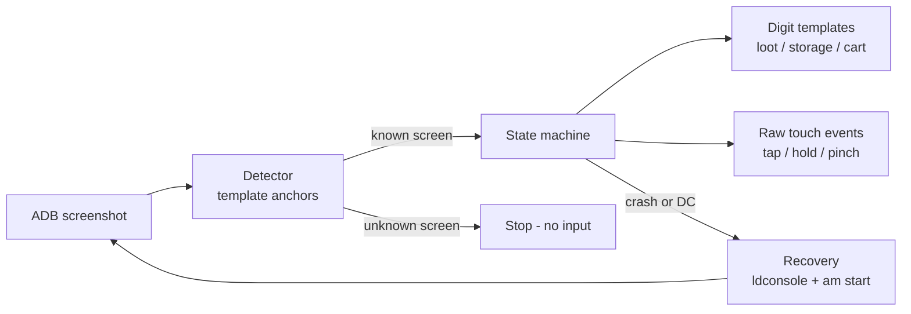

# CoC Auto — Clash of Clans farming bot for LDPlayer

A local Python bot that farms **Clash of Clans** on an **LDPlayer** emulator through ADB and OpenCV.
It attacks in both the **Home Village** and the **Builder Base**, filters opponents by loot,
claims rewards, and keeps going until both villages' gold and elixir storages are full —
reopening the emulator or the game by itself if anything closes or disconnects.


▶️ [Full-quality demo video (MP4)](docs/demo.mp4)

> [!WARNING]
> Automating Clash of Clans violates Supercell's Terms of Service. **Your account can be banned.**
> There is no anti-ban or detection evasion. Use it only on an account you are willing to lose.
> The bot never buys anything, never spends gems, never upgrades, and never logs in for you.

---

## Features

| Area | What it does |
| --- | --- |
| **One command** | `python bot.py --until-full --live` starts LDPlayer if it is off, opens CoC, and farms. |
| **Self-recovery** | Restarts a stopped LDPlayer (`ldconsole`), waits for ADB after a disconnect, and reopens CoC after a crash. |
| **Home Village** | Searches opponents with a minimum gold / elixir / dark-elixir filter (unlimited searches by default). |
| **Deploy plan** | Holds the main troop card until it is empty, drops the Grand Warden and fires its ability, throws spells along the troop path, then deploys the other heroes and the siege machine. |
| **Builder Base** | Spreads troops around the base, handles stage 2, and claims the **Elixir Cart** before every attack. |
| **Until full** | Attacks the Builder Base first, then the Home Village, and stops when gold and elixir are full in both. Capacity is read from the in-game storage tooltip, so it follows your Town Hall / storage level. |
| **Popups** | Star bonus, reward chest and reward card, and the "defence layout blocked" warning are handled. Unknown screens stop the bot. |
| **Speed** | Taps go through raw touch events, the camera is followed until it stops moving, and the battle speed is switched to **4x**. |
| **Safety** | Every tap is gated on a recognised screen; dry-run (no `--live`) never sends input. |

## Recommended armies

The bundled deploy plans were tuned for these armies. Other compositions work too, but deploy points and card order may need recalibration.

| Village | Troops | Spells | Notes |
| --- | --- | --- | --- |
| **Home Village** | Full **Dragons** | Full **Rage** or full **Freeze** | Heroes and a siege machine are optional; the sweep step deploys any card left in the bar. |
| **Builder Base** | Full **Baby Dragons** + Battle Machine | — | Spread around the base in stage 1, remaining troops and reinforcements in stage 2. |

Dragons are deployed by holding one edge point until the card is empty, and spells are thrown along the troops' path, so air armies give the most consistent results.

## How it works



- **Screens** are recognised by two small UI crops per screen (`anchors`), matched with OpenCV.
  A screen can have alternative anchor sets (`alt_anchors`) when it has two layouts, such as the win and loss result screens.
- **Numbers** (loot, storage bars, the "Maks" tooltip, the Elixir Cart) are read with per-digit templates built from real screenshots.
  Several font variants per digit are supported.
- **Input** is sent as raw multitouch events written to `/dev/input/eventN`, which makes holds and pinches possible.

## Requirements

- Windows with **LDPlayer** (tested on LDPlayer 14, Android 14, **1280×720**, Indonesian game language)
- **Python 3.10+**
- ADB from LDPlayer (`adb.exe`) with **local ADB debugging** enabled in LDPlayer settings
- Optional: Tesseract OCR — only a fallback when digit templates are not configured

## Installation

```bash
git clone https://github.com/peenjeee/coc-auto.git
cd coc-auto
python -m pip install -r requirements.txt
```

Enable ADB in LDPlayer (**Settings → Other settings → ADB debugging → Open local connection**) and check the device:

```bash
C:\LDPlayer\LDPlayer14\adb.exe devices
```

> [!IMPORTANT]
> The bundled calibration was built and tested with the game language set to **Bahasa Indonesia**
> on LDPlayer at **1280×720**. Screens are recognised from on-screen text and icons, so a different
> language, resolution, UI scale, or army layout will not match out of the box.
> If the bot stops with *"Layar tidak dikenal"* (unknown screen) or taps the wrong place,
> recalibrate it for your own setup — see [Calibration](#calibration).

## Quick start

The repository ships with the calibration that was used to build and test the bot (`config.json` + `calibration/`).
If your setup matches (1280×720, Indonesian UI, a similar army), you can start right away:

```bash
python bot.py --until-full --live
```

| Command | Purpose |
| --- | --- |
| `python bot.py` | Dry run: detect the current screen and, on a scout screen, read loot. No input. |
| `python bot.py --mode builder --cycles 1 --live` | One Builder Base attack. |
| `python bot.py --mode home --cycles 1 --live` | One Home Village attack. |
| `python bot.py --mode both --cycles 3 --live` | Alternate villages, three rounds. |
| `python bot.py --until-full --live` | Farm until both villages are full, with self-recovery. |

### CLI options — `bot.py`

| Option | Default | Description |
| --- | --- | --- |
| `--config PATH` | `config.json` | Calibration file to use. |
| `--mode {home,builder,both}` | `both` | Villages used by `--cycles` runs. |
| `--cycles N` | `1` | Rounds to attack (1–100). |
| `--searches N` | `0` | Opponent searches per Home attack; `0` means unlimited. |
| `--until-full` | off | Attack until gold and elixir are full in both villages. |
| `--max-recoveries N` | `20` | How many times `--until-full` may restart LDPlayer / CoC. |
| `--live` | off | Allow real taps. Without it the bot only observes. |

Stop at any time with **Ctrl+C**.

## Calibration

| Files | UI version |
| --- | --- |
| `config.json` + `calibration/` | Current game UI (after the latest update). |
| `config.legacy.json` + `calibration-legacy/` | Previous game UI, kept for reference. Run it with `python bot.py --config config.legacy.json`. |

Calibration is specific to resolution, language, UI scale, and army composition.
After a game update, or on a different setup, recalibrate the affected screens:

```bash
python calibrate.py --init --serial emulator-5554 --gold 500000 --elixir 500000
python calibrate.py --capture shot.png                  # save a screenshot (no input)
python calibrate.py --screen home --image shot.png      # pick anchors and tap points on a screenshot
python calibrate.py --screen home_scout --counts 1 1    # deploy screens need slot counts
python calibrate.py --learn-digits shot.png:GOLD:ELIXIR # build digit templates from labelled scouts
```

Calibration only works on screenshots and never taps the game. Existing profiles need `--replace`.

<details>
<summary><b>Configuration reference</b></summary>

| Key | Meaning |
| --- | --- |
| `adb`, `serial`, `resolution` | ADB executable, device serial, and screen size. |
| `ldconsole`, `ld_index` | LDPlayer console and instance index, used to start a stopped emulator. |
| `touch_device` | Raw touch input device, e.g. `/dev/input/event4`. |
| `minimum` | Loot filter for Home Village opponents (`0` disables a resource). |
| `screens.<name>.anchors` | Two UI crops that identify a screen; optional `margin` for small UI shifts. |
| `screens.<name>.alt_anchors` | Alternative anchor sets for screens with two layouts. |
| `screens.<name>.overrides` | Screens this one wins over when both match (e.g. stage 2 over battle). |
| `screens.<name>.actions` | Fixed tap points (attack, find, next, return, …). |
| `screens.<name>.targets` | Tap points found by image search (boat, Elixir Cart) with `pan`, `scales`, `avoid`, `alt_files`. |
| `screens.<deploy>.troops` | Ordered cards: `slot`, `count`, `hold`, `until_empty`, `points`, `tap_only`, `wait`. |
| `capacity.<village>.<resource>` | Storage bar crop, tooltip tap point, `max` crop, and `label` ("Maks:") template. Optional `maximum` forces a fixed value. |
| `cart_text` | Crop of the Elixir Cart "current / max" text. |
| `digits` | Folder of digit templates (`0.png` … `9.png`, plus variants like `9-ui2.png`). |
| `zoom_out` | Pinch settings used before switching villages or attacking. |
| `speed_button` | Template of the battle "1x" button, tapped once to switch to 4x. |

</details>

## Recovery behaviour

| Situation | What `--until-full` does |
| --- | --- |
| LDPlayer is not running | Starts it with `ldconsole launch`, waits for ADB and Android boot. |
| CoC is not open or crashed | Opens it with `am start` (retried while the launcher settles) and waits for the village. |
| ADB disconnects | Waits up to 5 minutes for the device, then resumes. |
| PC runs out of memory | Pauses, lets a running battle end, leaves the result screen, then resumes. |
| PC memory runs low (LDPlayer grows over hours) | Between attacks, restarts LDPlayer (at most every 30 minutes) when free memory drops below 500 MB, then reopens CoC. A failed recovery is retried. |
| Any other unexpected screen | Stops without sending input, so nothing is tapped blindly. |

## Testing

```bash
python -m unittest -v test_bot
```

The suite (103 tests) uses synthetic screens and a fake device. It covers screen detection, digit reading,
deploy plans, popups, recovery, and the until-full loop. It does not replace a live run on a real account.

## Project structure

```text
bot.py                 bot, detector, digit reader, ADB/emulator control, CLI
calibrate.py           calibration CLI (screenshots only, never taps)
test_bot.py            offline unit tests
config.json            calibration for the current game UI
calibration/           anchor, target and digit templates for config.json
config.legacy.json     calibration for the previous game UI
calibration-legacy/    templates for config.legacy.json
config.example.json    minimal config skeleton
docs/                  demo GIF and video
```

## Disclaimer

This project is for educational purposes. It is not affiliated with, endorsed by, or sponsored by Supercell.
Clash of Clans is a trademark of Supercell Oy. You are responsible for how you use it.
