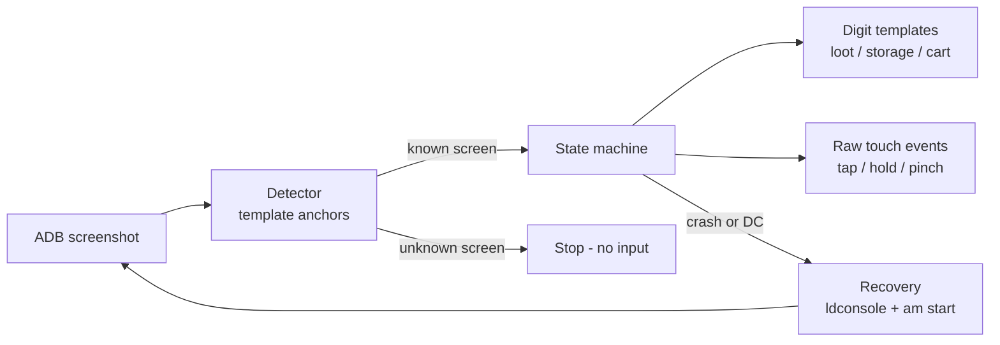

# CoC Auto — Clash of Clans farming bot for LDPlayer

A local Python bot that farms **Clash of Clans** on an **LDPlayer** emulator through ADB and OpenCV.
It attacks in both the **Home Village** and the **Builder Base**, filters opponents by loot,
claims rewards, and keeps going until both villages' gold and elixir storages are full —
reopening the emulator or the game by itself if anything closes or disconnects.


▶️ [Full-quality demo video (MP4)](docs/demo.mp4)

> [!WARNING]
> Automating Clash of Clans violates Supercell's Terms of Service. **Your account can be banned.**
> There is no anti-ban or detection evasion. Use it only on an account you are willing to lose.
> The bot never buys anything, never spends gems, never upgrades anything but walls (and only with `--walls`),
> and never logs in for you.

---

## Features

| Area | What it does |
| --- | --- |
| **One command** | `python bot.py --until-full --live` starts LDPlayer if it is off, opens CoC, and farms. |
| **Self-recovery** | Restarts a stopped LDPlayer (`ldconsole`), waits for ADB after a disconnect, and reopens CoC after a crash. |
| **Home Village** | Searches opponents with a minimum gold / elixir / dark-elixir filter (unlimited searches by default). |
| **Deploy plan** | Reads the card bar on the scout screen, so it follows whatever army is trained: holds each troop card at the deploy point until it is empty, drops the siege machine, then the Grand Warden (found by its green ground/air toggle) and the other heroes, each followed by its ability, and throws the spells in rounds of front, left and right, each round further into the base so no two spells share a spot. |
| **Builder Base** | Reads the card bar too: drops the Battle Machine or Battle Copter and fires its ability, spreads one troop card per point around the base, handles stage 2, and claims the **Elixir Cart** before every attack. |
| **Until full** | Attacks the Builder Base first, then the Home Village, and stops when gold and elixir are full in both. Capacity is read from the in-game storage tooltip, so it follows your Town Hall / storage level. |
| **Popups** | Star bonus, reward chest and reward card, and the "defence layout blocked" warning are handled. Unknown screens stop the bot. |
| **Speed** | Taps go through raw touch events, the camera is followed until it stops moving, and the battle speed is switched to **4x**. |
| **Safety** | Every tap is gated on a recognised screen; dry-run (no `--live`) never sends input. |

## Recommended armies

The bundled deploy plans were tuned for these armies. Other compositions work too, but deploy points and card order may need recalibration (see [Changing the army and deploy plan](#changing-the-army-and-deploy-plan)).

| Village | Troops | Spells | Notes |
| --- | --- | --- | --- |
| **Home Village** | Full **Dragons** | Full **Rage** or full **Freeze** | Heroes and a siege machine are optional; the sweep step deploys any card left in the bar. |
| **Builder Base** | Full **Baby Dragons** + Battle Machine | — | Spread around the base in stage 1, remaining troops and reinforcements in stage 2. |

Dragons are deployed by holding one edge point until the card is empty, and spells are thrown along the troops' path, so air armies give the most consistent results.

## How it works



- **Screens** are recognised by two or more small UI crops per screen (`anchors`), matched with OpenCV.
  A screen can have alternative anchor sets (`alt_anchors`) when it has two layouts, such as the win and loss result screens.
  The two villages are told apart by their elixir icons (pink in the Home Village, violet in the Builder Base), which
  every Town Hall and Builder Hall level shows, so a Town Hall below 7 (no dark elixir bar) is still the Home Village
  and never taken for the Builder Base.
- **Numbers** (loot, storage bars, the "Maks" tooltip, the Elixir Cart) are read with per-digit templates built from real screenshots.
  Several font variants per digit are supported.
- **Input** is sent as raw multitouch events written to `/dev/input/eventN`, which makes holds and pinches possible.

## Requirements

- Windows with **LDPlayer** (tested on LDPlayer 14, Android 14, **1280×720**, Indonesian game language)
- **Python 3.10+**
- ADB from LDPlayer (`adb.exe`) with **local ADB debugging** enabled in LDPlayer settings
- Optional: Tesseract OCR — only a fallback when digit templates are not configured

## Installation

```bash
git clone https://github.com/peenjeee/coc-auto.git
cd coc-auto
python -m pip install -r requirements.txt
```

Enable ADB in LDPlayer (**Settings → Other settings → ADB debugging → Open local connection**) and check the device:

```bash
C:\LDPlayer\LDPlayer14\adb.exe devices
```

> [!IMPORTANT]
> The bundled calibration was built and tested with the game language set to **Bahasa Indonesia**
> on LDPlayer at **1280×720**. Screens are recognised from on-screen text and icons, so a different
> language, resolution, UI scale, or army layout will not match out of the box.
> If the bot stops with *"Layar tidak dikenal"* (unknown screen) or taps the wrong place,
> recalibrate it for your own setup — see [Calibration](#calibration).

## First-time setup for another PC or account

The bundled `config.json` was made on one PC for one account. Before the first live run on yours, check each
row below. Everything here is either an LDPlayer setting or a key in `config.json`.

| What | Must be | Why / how to check |
| --- | --- | --- |
| LDPlayer resolution | **1280×720, DPI 240** (Settings → Advanced → Resolution) | Screens are matched pixel for pixel. DPI changes the UI scale, so at another DPI no template matches even at 1280×720. |
| Game language | **Bahasa Indonesia** | Many anchors are Indonesian text ("Pertempuran", "Tembok", "Maks:"). With another language every text anchor has to be recalibrated. |
| `adb`, `ldconsole` | Paths in your LDPlayer install folder | e.g. `C:\LDPlayer\LDPlayer14\adb.exe` and `C:\LDPlayer\LDPlayer14\ldconsole.exe`; the folder name depends on the LDPlayer version. |
| `ld_index`, `serial` | Your instance | `ld_index` is the instance number in LDMultiPlayer (0 for the first). `serial` is `emulator-<5554 + 2 × index>`: `emulator-5554` for index 0, `emulator-5556` for index 1. Check with `adb devices`. |
| `touch_device`, `zoom_out.device` | The touchscreen node | Run `adb -s <serial> shell getevent -pl` and use the `/dev/input/eventN` whose block lists `ABS_MT_POSITION_X`. Set both keys to it; holds, pinches and fast taps go there. |
| `minimum` | A loot filter that fits your Town Hall | `500000` gold and elixir suits high Town Halls. Lower it for a low Town Hall, or every opponent is skipped. `0` turns a resource off. |
| `tesseract` | Only when `digits` is not set | Loot is read with the digit templates in `calibration/digits`. Tesseract is needed only if you remove `digits`. |

Then open the village and run the dry run, which sends no input:

```bash
python bot.py
```

It should log `Dry-run: layar=home` (or `builder`). *"Layar tidak dikenal"* means the screen does not match; recheck
resolution, DPI and language before recalibrating anything.

## Quick start

The repository ships with the calibration that was used to build and test the bot (`config.json` + `calibration/`).
If your setup matches (see [First-time setup](#first-time-setup-for-another-pc-or-account)), you can start right away:

```bash
python bot.py --until-full --live
```

| Command | Purpose |
| --- | --- |
| `python bot.py` | Dry run: detect the current screen and, on a scout screen, read loot. No input. |
| `python bot.py --mode builder --cycles 1 --live` | One Builder Base attack. |
| `python bot.py --mode home --cycles 1 --live` | One Home Village attack. |
| `python bot.py --mode both --cycles 3 --live` | Alternate villages, three rounds. |
| `python bot.py --until-full --live` | Farm until both villages are full, with self-recovery. |

### Choosing what to fill

`--builder` and `--home` pick the village and the resources to fill. Each takes a comma-separated list or `all`,
and either one alone farms only that village. Without both, `--until-full` fills Builder Base gold, elixir and the
Elixir Cart, then Home Village gold and elixir.

| Village | Resources | `all` means |
| --- | --- | --- |
| `--builder` | `gold`, `elixir`, `cart` (Elixir Cart) | `gold,elixir,cart` |
| `--home` | `gold`, `elixir`, `dark` (dark elixir) | `gold,elixir,dark` |

```bash
python bot.py --builder gold --live
```
```bash
python bot.py --builder elixir,cart --live
```
```bash
python bot.py --home gold,dark --live
```
```bash
python bot.py --builder all --home all --first home --live
```

The first command fills Builder Base gold only, the second Builder Base elixir and the Elixir Cart, and the third
Home Village gold and dark elixir. The last fills everything in both villages, Home Village first. Use
`--home gold,elixir` instead of `--home all` to leave dark elixir out. A resource must be calibrated before it can
be chosen (dark elixir needs a `capacity.home.dark` entry); the bot refuses to start otherwise. If the Elixir Cart
cannot be found on 5 Builder Base visits in a row, its fill cannot be read, so `cart` counts as done for the rest of
the run instead of keeping the bot attacking forever.

### Upgrading walls

```bash
python bot.py --walls home --live
```
```bash
python bot.py --walls both --first home --live
```

`--walls` takes `home`, `builder` or `both`. For each village in turn it first spends the gold and elixir already
in storage: it opens the builder list, finds a "Tembok" row, and upgrades one wall at a time with whichever of gold or
elixir is still affordable. It always takes the lowest wall level first, and moves on to the next level only when that one is used up. Each wall level costs more than the one below, so it reads the price on every "Tembok" row and picks the cheapest. Position in the list says nothing about level: the game puts affordable rows above ones the storage cannot pay for. When neither resource is affordable any more, it
farms until gold and elixir are both full, spends them again, and repeats. It stops once no "Tembok" row is left, which means
every wall is at the maximum level for the current Town Hall or Builder Hall. In the Builder Base it also claims the
Elixir Cart first; its walls cost gold only until they reach higher levels, and only the upgrade buttons a wall actually shows are used. If storage is full and still no wall can be upgraded, the run stops instead of looping. `--first` picks the village to finish first when `both` is chosen.

The bot never spends gems. It taps an upgrade only when its price is shown in white, and taps Konfirmasi only when
the dialog is a wall upgrade, its price is white, and its icon is the chosen gold or elixir. It reads the gem count
before and after every upgrade and keeps the last trusted count across recoveries. A count that drops with the same
number of digits stops the run for good, without any recovery. A count with other digits or a higher one is treated
as a misread: nothing is tapped and recovery reads it again. In the Home Village it also keeps a gold reserve (`walls.home.gold_reserve`, 200,000) for opponent searches, which cost gold: a gold upgrade that would dip below it is closed and that session continues with elixir. A village needs a
`walls.<village>` calibration before `--walls` accepts it.

### CLI options — `bot.py`

| Option | Default | Description |
| --- | --- | --- |
| `--config PATH` | `config.json` | Calibration file to use. |
| `--mode {home,builder,both}` | `both` | Villages used by `--cycles` runs. |
| `--cycles N` | `1` | Rounds to attack (1–100). |
| `--searches N` | `0` | Opponent searches per Home attack; `0` means unlimited. At the limit the base on screen is attacked whatever its loot, so the run never stops for want of a good base. |
| `--until-full` | off | Attack until gold and elixir are full in both villages. |
| `--builder RESOURCES` | – | Fill these Builder Base resources (`gold`, `elixir`, `cart`, or `all`). Implies `--until-full`. |
| `--home RESOURCES` | – | Fill these Home Village resources (`gold`, `elixir`, `dark`, or `all`). Implies `--until-full`. |
| `--first {builder,home}` | `builder` | Which village to work on first when both are chosen. |
| `--walls {home,builder,both}` | – | Spend the stored gold and elixir on walls, then farm both full and repeat until every wall is maxed. Never uses gems. |
| `--max-recoveries N` | `20` | How many recoveries (restarting LDPlayer or CoC, settling a stalled screen) `--until-full` and `--walls` may make without progress. The count starts again after every finished attack or upgraded wall. |
| `--live` | off | Allow real taps. Without it the bot only observes. |

Stop at any time with **Ctrl+C**.

## Calibration

| Files | UI version |
| --- | --- |
| `config.json` + `calibration/` | Current game UI (after the latest update). |
| `config.legacy.json` + `calibration-legacy/` | Previous game UI, kept for reference. Run it with `python bot.py --config config.legacy.json`. |

Calibration is specific to resolution, language, UI scale, and army composition.
After a game update, or on a different setup, recalibrate the affected screens:

```bash
python calibrate.py --init --serial emulator-5554 --gold 500000 --elixir 500000
python calibrate.py --capture shot.png                  # save a screenshot (no input)
python calibrate.py --screen home --image shot.png      # pick anchors and tap points on a screenshot
python calibrate.py --screen home_scout --counts 1 1    # a new deploy screen needs slot counts
python calibrate.py --screen gem_offer --image shot.png --replace  # recalibrate an existing screen
python calibrate.py --learn-digits shot.png:GOLD:ELIXIR # build digit templates from labelled scouts
```

Calibration only works on screenshots and never taps the game. `--screen` takes every screen the bot knows, popups
and wall menus included. An existing screen needs `--replace`, which picks new anchors and tap points and keeps
everything else it has (`targets`, `auto`, `sweep`, `overrides`, `alt_anchors`, `deploy`, `troops`, `loot`); tap
points that a target already finds are not asked again.

### Changing the army and deploy plan

The army and how it is deployed live in `config.json`; no code changes are needed.

| Village | Key |
| --- | --- |
| Home Village | `screens.home_scout.auto` (reads the card bar; takes precedence over `troops`), plus `screens.home_scout.sweep` |
| Builder Base, stage 1 | `screens.builder_scout.auto` (reads the card bar; takes precedence over `troops`) |
| Builder Base, stage 2 | `screens.builder_stage2.auto` (reads the card bar; takes precedence over `troops`) |

A deploy screen with an `auto` entry builds its plan from the cards in the bar on every attack, once two frames in a
row show the same cards, so a new army needs no slot changes; its `troops` list is then ignored. In the Home Village
`auto` has three fields:

| Field | Meaning |
| --- | --- |
| `bar` | `[x, y, width, height]` of the card bar. |
| `hold` | Seconds each troop card is held at the screen's `deploy` point; it stops early once the card is grey. |
| `spells` | Spell drop points, listed as rounds of front, left and right, each round further into the base. |

In the Builder Base `auto` has `bar` and `points` instead. Troop cards carry a magenta header and hero cards (Battle
Machine, Battle Copter) do not. Each hero is dropped at the screen's `deploy` point and then tapped again for its
ability. One tap deploys a whole troop camp, so each troop card is tapped once, at the next point of `points` in
turn; cards greyed out in stage 1 are skipped. There are no spells.

| Field | Meaning |
| --- | --- |
| `bar` | `[x, y, width, height]` of the card bar, header included (the troop headers sit higher than in the Home Village). |
| `points` | Spread drop points around the base, used one per troop card. |

Without `auto`, `troops` is an ordered list. Each item is one card in the troop bar, used in list order:

| Field | Meaning |
| --- | --- |
| `slot` | `[x, y]` of the card in the troop bar. Required. |
| `count` | How many taps to drop from this card. Required. |
| `deploy` | One drop point `[x, y]` for this card. Defaults to the screen's own `deploy` point. |
| `points` | Several drop points; taps cycle through them (e.g. spells along the troop path). Overrides `deploy`. |
| `hold` | Seconds to keep a finger down on the first drop point instead of tapping (fast for dragons). |
| `until_empty` | Stop this card as soon as it is greyed out (empty). |
| `tap_only` | Only tap the card itself, e.g. a second tap on a hero to fire its ability. |
| `wait` | Seconds to wait before this card. |

Example of a fixed `troops` plan:

```json
{"slot": [130, 650], "count": 1, "hold": 6, "until_empty": true},
{"slot": [545, 650], "count": 1},
{"slot": [545, 650], "count": 1, "tap_only": true},
{"slot": [845, 650], "count": 4, "until_empty": true, "points": [[230, 345], [320, 342], [410, 338], [500, 335]]}
```

This holds the first card until it is empty, drops the hero in slot 545, taps it again for its ability, then throws four spells along a line.

After the list, the Home Village `sweep` taps every card in `sweep.slots` that still has troops left at `sweep.deploy`, so nothing is wasted when the army differs from the plan.

How to change it:

1. Card positions depend on army order, so with fixed `troops` re-check every `slot` after changing the army.
2. The bot zooms out (`zoom_out`) before deploying, so drop points must be read from a **zoomed-out** battle screen, not a normal scout screenshot. Start an attack, zoom out like the bot does, then save a screenshot with `python calibrate.py --capture shot.png` and read pixel positions in any image viewer.
3. Edit `config.json`, then check it without input: `python bot.py`.
4. Test one attack: `python bot.py --mode home --cycles 1 --live` (or `--mode builder`).

<details>
<summary><b>Configuration reference</b></summary>

| Key | Meaning |
| --- | --- |
| `adb`, `serial`, `resolution` | ADB executable, device serial, and screen size. |
| `ldconsole`, `ld_index` | LDPlayer console and instance index, used to start a stopped emulator. |
| `touch_device` | Raw touch input device, e.g. `/dev/input/event4`. |
| `tesseract` | Tesseract executable; used for loot only when `digits` is not set. |
| `minimum` | Loot filter for Home Village opponents (`0` disables a resource). |
| `screens.<name>.anchors` | Two or more UI crops that must all match to identify a screen; optional `margin` for small UI shifts. |
| `screens.<name>.alt_anchors` | Alternative anchor sets for screens with two layouts. |
| `screens.<name>.overrides` | Screens this one wins over when both match (e.g. stage 2 over battle). |
| `screens.<name>.actions` | Fixed tap points (attack, find, next, return, …). Menus may add an optional `close`. |
| `screens.<name>.targets` | Tap points found by image search (boat, Elixir Cart) with `pan`, `scales`, `avoid`, `alt_files`. |
| `screens.<deploy>.troops` | Ordered cards: `slot`, `count`, `hold`, `until_empty`, `points`, `tap_only`, `wait`. |
| `screens.<deploy>.auto` | Build the deploy order from the card bar instead of `troops`. Home Village: `bar` region, troop `hold` seconds, and `spells` points listed as rounds of front, left, right. Builder Base: `bar` region and spread `points`, one per troop card. |
| `capacity.<village>.<resource>` | Storage bar crop, tooltip tap point, `max` crop, and `label` ("Maks:") template. Optional `maximum` forces a fixed value. Needs `digits`. |
| `storage.<village>.<resource>` | Fallback fill check by bar colour (`row`, `left`, `right`, `hue`, `min_saturation`), used when a village has no `capacity`. |
| `cart_text` | Crop of the Elixir Cart "current / max" text, read with `digits`. |
| `cart_bar` | Elixir Cart fill bar read by colour, used when there is no `cart_text`. Either key makes `cart` a goal. |
| `walls.<village>` | `--walls` calibration: builder list tap point, "Tembok" row template and its price band (`row.price` = `[x, dy, w, h]`, `dy` from the row title's centre), scroll swipe, gem count areas, upgrade button template and price offsets, the confirm dialog checks, and the Home Village `gold_reserve`. |
| `digits` | Folder of digit templates (`0.png` … `9.png`, plus variants like `9-ui2.png`). |
| `zoom_out` | Pinch settings used before switching villages or attacking. |
| `speed_button` | Template of the battle "1x" button, tapped once to switch to 4x. |

</details>

## Recovery behaviour

| Situation | What `--until-full` and `--walls` do |
| --- | --- |
| LDPlayer is not running | Starts it with `ldconsole launch`, waits for ADB and Android boot. |
| CoC is not open or crashed | Opens it with `am start` (retried while the launcher settles) and waits for the village. |
| ADB disconnects | Waits up to 5 minutes for the device, then resumes. |
| PC runs out of memory | Pauses, lets a running battle end, leaves the result screen, then resumes. Any other error while free memory is below 1 GB is handled the same way. |
| PC memory runs low (LDPlayer grows over hours) | Between attacks, restarts LDPlayer (at most every 30 minutes) when free memory drops below 1 GB, then reopens CoC. A failed recovery is retried, and LDPlayer is restarted when its VM never brings ADB back or its screen cannot be captured. |
| Started mid-battle, on a result screen, or on an attack menu | Waits for the battle to end and taps return, or closes the menu (when it has a `close` point), then starts farming. |
| A menu tap is lost (e.g. right after LDPlayer boots) | Taps the same button again, up to 3 times, while that menu is still shown. The search button is retried for up to 3 minutes to wait out the attack cooldown after a game restart. |
| A wait times out, or an unrecognised screen passes, with the game still open (slow matchmaking, lag, an animation) | Lets a running battle end or closes the menu, then resumes. Counts as one recovery. |
| The search is refused ("Tidak dapat menyerang desa! Coba lagi nanti.") | Taps "Ke Beranda", waits a minute, and tries again. Counts as one recovery. |
| The game offers to buy missing resources with gems ("Perlu lebih banyak …") | Closes it with X, never the gem button. If it came from skipping an opponent with no gold left, attacks the opponent on screen; otherwise recovers. |
| The account is opened on another device ("Perangkat lain tersambung ke desa ini") | Stops without reloading, so the other session stays; exit code 4. Run the bot again when you are done there. |
| The game disconnects for inactivity ("Ada orang di sana?") | Taps "Muat ulang game" and carries on. |
| All builders are busy when a Builder Base wall is picked ("Semua tukang sibuk!") | Closes the gem offer with X and skips that village's walls; run again once a builder is free. |
| Any other unexpected screen | Stops without sending input, so nothing is tapped blindly. |

Every recovery counts towards `--max-recoveries` (20). A finished attack or an upgraded wall starts the count again,
so the run stops only after that many recoveries with no progress in between.

## Testing

```bash
python -m unittest -v test_bot
```

The suite (176 tests) uses synthetic screens and a fake device, plus real screen crops in `fixtures/`. It covers screen detection, digit reading,
deploy plans, popups, recovery, and the until-full loop. It does not replace a live run on a real account.

## Project structure

```text
bot.py                 bot, detector, digit reader, ADB/emulator control, CLI
calibrate.py           calibration CLI (screenshots only, never taps)
test_bot.py            offline unit tests
config.json            calibration for the current game UI
calibration/           anchor, target and digit templates for config.json
config.legacy.json     calibration for the previous game UI
calibration-legacy/    templates for config.legacy.json
config.example.json    minimal config skeleton
docs/                  demo GIF and video
```

## Disclaimer

This project is for educational purposes. It is not affiliated with, endorsed by, or sponsored by Supercell.
Clash of Clans is a trademark of Supercell Oy. You are responsible for how you use it.
