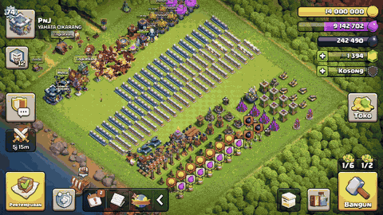
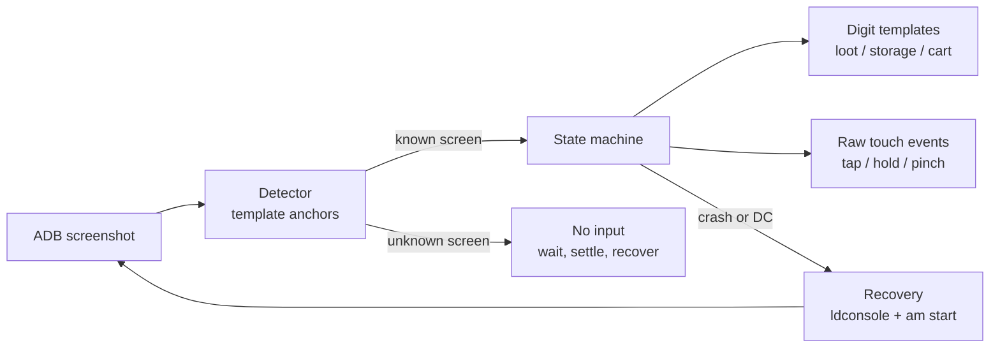
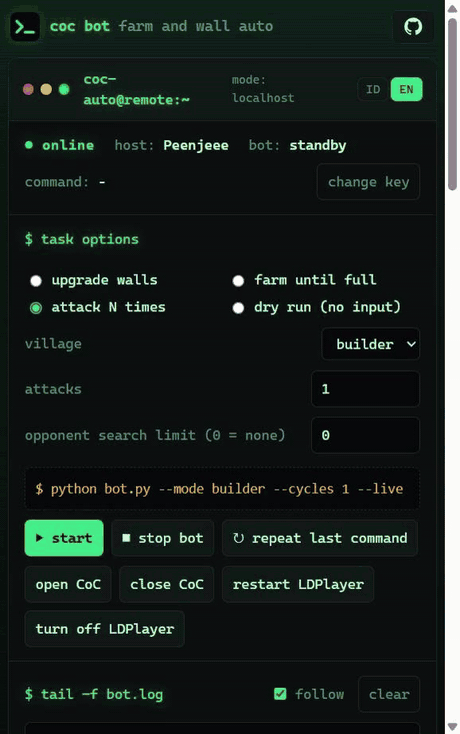
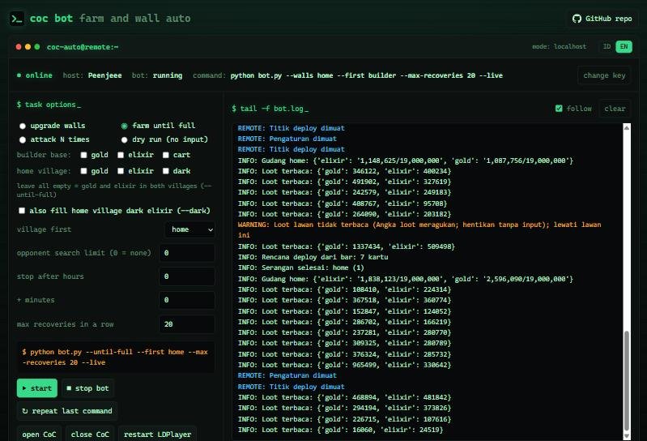
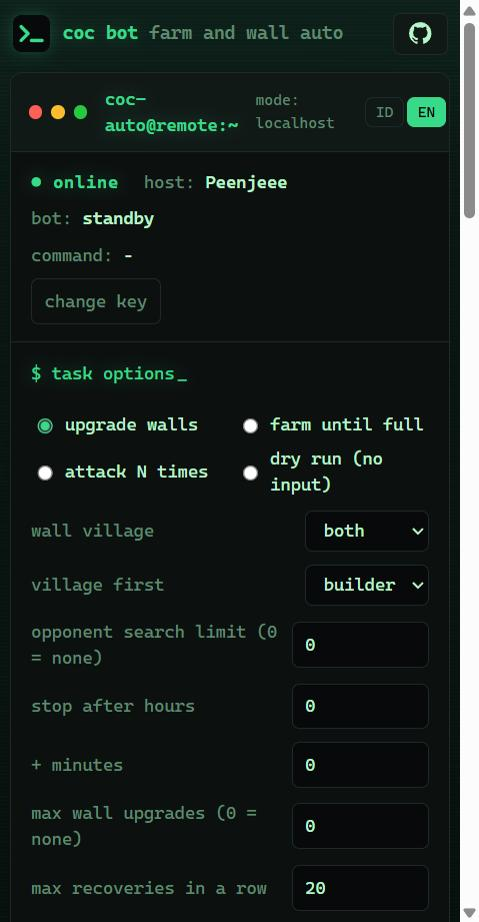
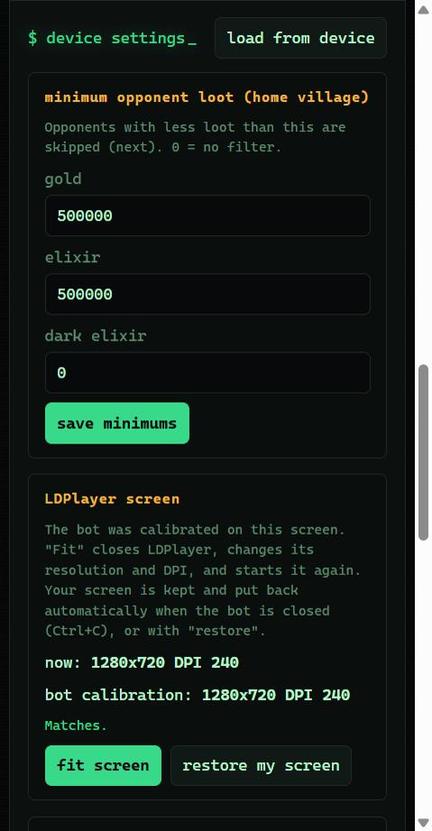
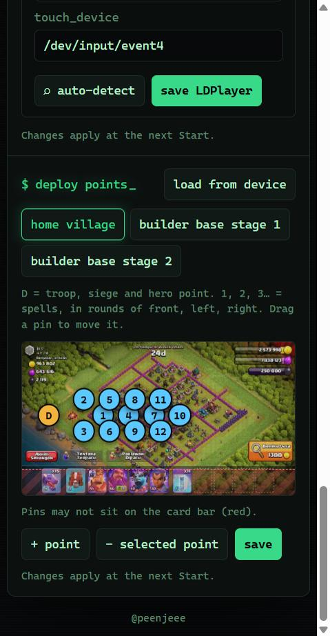

# CoC Auto — Clash of Clans farming bot for LDPlayer

A local Python bot that farms **Clash of Clans** on an **LDPlayer** emulator through ADB and OpenCV.
It attacks in both the **Home Village** and the **Builder Base**, filters opponents by loot,
claims rewards, and keeps going until both villages' gold and elixir storages are full —
reopening the emulator or the game by itself if anything closes or disconnects.



▶️ [Full-quality demo video (MP4)](docs/demo.mp4) · 🖥️ [Web dashboard](#web-dashboard)

> [!WARNING]
> Automating Clash of Clans violates Supercell's Terms of Service. **Your account can be banned.**
> There is no anti-ban or detection evasion. Use it only on an account you are willing to lose.
> The bot never buys anything, never spends gems, never upgrades anything but walls (and only with `--walls`),
> and never logs in for you.

---

## Features

| Area | What it does |
| --- | --- |
| **One command** | `python bot.py --until-full --live` starts LDPlayer if it is off, opens CoC, and farms. |
| **Self-recovery** | Restarts a stopped LDPlayer (`ldconsole`), waits for ADB after a disconnect, and reopens CoC after a crash. |
| **Home Village** | Searches opponents with a minimum gold / elixir / dark-elixir filter (unlimited searches by default). |
| **Deploy plan** | Reads the card bar on the scout screen, so it follows whatever army is trained: holds each troop card at the deploy point until it is empty, drops the siege machine, then the Grand Warden (found by its green ground/air toggle) and the other heroes, each followed by its ability, and throws the spells in rounds of front, left and right, each round further into the base so no two spells share a spot. |
| **Builder Base** | Reads the card bar too: drops the Battle Machine or Battle Copter and fires its ability, spreads one troop card per point around the base, handles stage 2, and claims the **Elixir Cart** before every attack. |
| **Until full** | Attacks the Builder Base first, then the Home Village, and stops when gold and elixir are full in both. Capacity is read from the in-game storage tooltip, so it follows your Town Hall / storage level. |
| **Popups** | Star bonus, reward chest and reward card, and the "defence layout blocked" warning are handled. Nothing is ever tapped on an unknown screen: the bot waits, settles and restarts the game, and stops after `--max-recoveries` without progress. |
| **Walls** | `--walls` spends stored gold and elixir on walls, cheapest level first, then farms both full and repeats until every wall is maxed. It never spends gems. |
| **Web dashboard** | Live log and full control from a phone or the PC: start any command, stop, open/close CoC, restart LDPlayer, set loot minimums, auto-detect LDPlayer, fit its screen, and move deploy pins over a real attack screen. Installable as an app. |
| **Speed** | Taps go through raw touch events, the camera is followed until it stops moving, and the battle speed is switched to **4x**. |
| **Safety** | Every tap is gated on a recognised screen; dry-run (no `--live`) never sends input. A setup that cannot work (taps that cannot land, ADB debugging off, a loot minimum no opponent meets) stops the run with what to change. |

## Recommended armies

The bundled deploy plans were tuned for these armies. Other compositions work too, but deploy points and card order may need recalibration (see [Changing the army and deploy plan](#changing-the-army-and-deploy-plan)).

| Village | Troops | Spells | Notes |
| --- | --- | --- | --- |
| **Home Village** | Full **Dragons** | Full **Rage** or full **Freeze** | Heroes and a siege machine are optional; the sweep step deploys any card left in the bar. |
| **Builder Base** | Full **Baby Dragons** + Battle Machine | — | Spread around the base in stage 1, remaining troops and reinforcements in stage 2. |

Dragons are deployed by holding one edge point until the card is empty, and spells are thrown along the troops' path, so air armies give the most consistent results.

## How it works



- **Screens** are recognised by two or more small UI crops per screen (`anchors`), matched with OpenCV.
  A screen can have alternative anchor sets (`alt_anchors`) when it has two layouts, such as the win and loss result screens.
  The two villages are told apart by their elixir icons (pink in the Home Village, violet in the Builder Base), which
  every Town Hall and Builder Hall level shows, so a Town Hall below 7 (no dark elixir bar) is still the Home Village
  and never taken for the Builder Base.
- **Numbers** (loot, storage bars, the "Maks" tooltip, the Elixir Cart) are read with per-digit templates built from real screenshots.
  Several font variants per digit are supported.
- **Input** is sent as raw multitouch events written to `/dev/input/eventN`, which makes holds and pinches possible.

## Requirements

- Windows with **LDPlayer** (tested on LDPlayer 14, Android 14, **1280×720**, Indonesian game language)
- **Python 3.10+**
- ADB from LDPlayer (`adb.exe`) with **local ADB debugging** enabled in LDPlayer settings (the dashboard's "fit
  screen" turns it on)
- A **64-bit** LDPlayer (LDPlayer 9 or newer): touch input is written as 64-bit Linux input events
- Optional: Tesseract OCR — only a fallback when digit templates are not configured

The account:

- A **Dark Elixir Storage** (Town Hall 7+) only for dark elixir (`--dark`, `--home dark`). `--walls home` works with
  or without one: without a dark elixir bar the gem bar moves up into its row, and the bot finds it by its green gem
  icon before every wall session (no gem icon, no upgrade).
- **Builder Base unlocked** for the default `--until-full` and for `--builder`/`--walls builder`; without it use
  `--home`.
- A loot `minimum` and `walls.home.gold_reserve` that fit the Town Hall (see
  [First-time setup](#first-time-setup-for-another-pc-or-account)).

## Installation

```bash
git clone https://github.com/peenjeee/coc-auto.git
cd coc-auto
python -m pip install -r requirements.txt
```

Enable ADB in LDPlayer (**Settings → Other settings → ADB debugging → Open local connection**) and check the device:

```bash
C:\LDPlayer\LDPlayer14\adb.exe devices
```

> [!IMPORTANT]
> The bundled calibration was built and tested with the game language set to **Bahasa Indonesia**
> on LDPlayer at **1280×720**. Screens are recognised from on-screen text and icons, so a different
> language, resolution, UI scale, or army layout will not match out of the box.
> If the bot stops with *"Layar tidak dikenal"* (unknown screen) or taps the wrong place,
> recalibrate it for your own setup — see [Calibration](#calibration).

## First-time setup for another PC or account

The bundled `config.json` was made on one PC for one account. Before the first live run on yours, check each
row below. Everything here is either an LDPlayer setting or a config key. Put your own values in
**`config.local.json`** next to `config.json`, with only the keys you change (for example
`{"serial": "emulator-5556", "ld_index": 1, "minimum": {"gold": 200000}}`). It is read on top of `config.json`, is
not in git, so `git pull` never collides with it, and the dashboard saves its settings and moved deploy pins there.

| What | Must be | Why / how to check |
| --- | --- | --- |
| LDPlayer resolution | **1280×720, DPI 240** (Settings → Advanced → Resolution, or "fit screen" in the dashboard) | Screens are matched pixel for pixel. DPI changes the UI scale, so at another DPI no template matches even at 1280×720. |
| Game language | **Bahasa Indonesia** | Many anchors are Indonesian text ("Pertempuran", "Tembok", "Maks:"). With another language every text anchor has to be recalibrated. Set it in CoC's own settings: CoC keeps its own language, so changing Android's or LDPlayer's language does not change it. |
| `adb`, `ldconsole` | Paths in your LDPlayer install folder | e.g. `C:\LDPlayer\LDPlayer14\adb.exe` and `C:\LDPlayer\LDPlayer14\ldconsole.exe`; the folder name depends on the LDPlayer version. |
| `ld_index`, `serial` | Your instance | `ld_index` is the instance number in LDMultiPlayer (0 for the first). `serial` is `emulator-<5554 + 2 × index>`: `emulator-5554` for index 0, `emulator-5556` for index 1. Check with `adb devices`. |
| `touch_device`, `zoom_out.device` | The touchscreen node | Run `adb -s <serial> shell getevent -pl` and use the `/dev/input/eventN` whose block lists `ABS_MT_POSITION_X`. Set both keys to it; holds, pinches and fast taps go there. |
| `minimum` | A loot filter that fits your Town Hall | `500000` gold and elixir suits high Town Halls. Lower it for a low Town Hall, or every opponent is skipped. `0` turns a resource off. If searching runs out of gold 3 attacks in a row, the bot stops (exit code 6) and asks you to lower it. |
| `walls.home.gold_reserve` | Gold kept for searching | `200000` by default; lower it for a low Town Hall whose gold storage is small, or gold wall upgrades never pass it. |
| `tesseract` | Only when `digits` is not set | Loot is read with the digit templates in `calibration/digits`. Tesseract is needed only if you remove `digits`. |

The LDPlayer rows (`adb`, `ldconsole`, `ld_index`, `serial`, `touch_device`) can also be filled from the
[web dashboard](#web-dashboard): **auto-detect** under device settings finds the LDPlayer folder, the running instance,
its adb serial, the touchscreen node and the screen size, and lists anything that does not fit (for example a
resolution other than 1280×720). Check the result and press save. `minimum` can be set there too.

Then open the village and run the dry run, which sends no input:

```bash
python bot.py
```

It should log `Dry-run: layar=home` (or `builder`). *"Layar tidak dikenal"* means the screen does not match; recheck
resolution, DPI and language before recalibrating anything. Like every command, it then stays on standby for the
dashboard; leave with **Ctrl+C**, or run `python bot.py --no-remote` to exit right after the check.

## Quick start

The repository ships with the calibration that was used to build and test the bot (`config.json` + `calibration/`).
If your setup matches (see [First-time setup](#first-time-setup-for-another-pc-or-account)), you can start right away:

```bash
python bot.py --until-full --live
```

| Command | Purpose |
| --- | --- |
| `python bot.py` | Dry run: detect the current screen and, on a scout screen, read loot. No input. |
| `python bot.py --mode builder --cycles 1 --live` | One Builder Base attack. |
| `python bot.py --mode home --cycles 1 --live` | One Home Village attack. |
| `python bot.py --mode both --cycles 3 --live` | Alternate villages, three rounds. |
| `python bot.py --until-full --live` | Farm until both villages are full, with self-recovery. |

### Choosing what to fill

`--builder` and `--home` pick the village and the resources to fill. Each takes a comma-separated list or `all`,
and either one alone farms only that village. Without both, `--until-full` fills Builder Base gold, elixir and the
Elixir Cart, then Home Village gold and elixir. Add `--dark` to fill Home Village dark elixir as well:

```bash
python bot.py --until-full --dark --live
```

| Village | Resources | `all` means |
| --- | --- | --- |
| `--builder` | `gold`, `elixir`, `cart` (Elixir Cart) | `gold,elixir,cart` |
| `--home` | `gold`, `elixir`, `dark` (dark elixir) | `gold,elixir,dark` |

```bash
python bot.py --builder gold --live
```
```bash
python bot.py --builder elixir,cart --live
```
```bash
python bot.py --home gold,dark --live
```
```bash
python bot.py --builder all --home all --first home --live
```

The first command fills Builder Base gold only, the second Builder Base elixir and the Elixir Cart, and the third
Home Village gold and dark elixir. The last fills everything in both villages, Home Village first. Use
`--home gold,elixir` instead of `--home all` to leave dark elixir out. A resource must be calibrated before it can
be chosen (dark elixir needs a `capacity.home.dark` entry); the bot refuses to start otherwise. If the Elixir Cart
cannot be found on 5 Builder Base visits in a row, its fill cannot be read, so `cart` counts as done for the rest of
the run instead of keeping the bot attacking forever.

### Upgrading walls

```bash
python bot.py --walls home --live
```
```bash
python bot.py --walls both --first home --live
```
```bash
python bot.py --walls home --hours 3 --live
```
```bash
python bot.py --walls home --max-upgrades 20 --minutes 45 --live
```

`--walls` takes `home`, `builder` or `both`. For each village in turn it first spends the gold and elixir already
in storage: it opens the builder list, finds a "Tembok" row, and upgrades one wall at a time with whichever of gold or
elixir is still affordable. It always takes the lowest wall level first, and moves on to the next level only when that one is used up. Each wall level costs more than the one below, so it reads the price on every "Tembok" row and picks the cheapest. Position in the list says nothing about level: the game puts affordable rows above ones the storage cannot pay for. When neither resource is affordable any more, it
farms until gold and elixir are both full, spends them again, and repeats. It stops once no "Tembok" row is left, which means
every wall is at the maximum level for the current Town Hall or Builder Hall. In the Builder Base it also claims the
Elixir Cart first; its lower walls cost gold only, higher ones gold or elixir (gold first, like the Home Village), and only the upgrade buttons a wall actually shows are used. Builder Base walls also need a free builder: with every builder busy the game offers to free one for gems, and the bot closes that offer with X and skips the Builder Base walls for that run. If storage is full and still no wall can be upgraded, the run stops instead of looping. `--first` picks the village to finish first when `both` is chosen.
The bot never spends gems. It taps an upgrade only when its price is shown in white, and taps Konfirmasi only when
the dialog is a wall upgrade, its price is white, and its icon is the chosen gold or elixir. It reads the gem count
before and after every upgrade and keeps the last trusted count across recoveries. A count that drops with the same
number of digits stops the run for good, without any recovery. A count with other digits or a higher one is treated
as a misread: nothing is tapped and recovery reads it again. In the Home Village it also keeps a gold reserve (`walls.home.gold_reserve`, 200,000) for opponent searches, which cost gold: a gold upgrade that would dip below it is closed and that session continues with elixir. A village needs a
`walls.<village>` calibration before `--walls` accepts it.

### CLI options — `bot.py`

| Option | Default | Description |
| --- | --- | --- |
| `--config PATH` | `config.json` next to `bot.py` | Calibration file to use; `config.local.json` beside it is read on top. |
| `--mode {home,builder,both}` | `both` | Villages used by `--cycles` runs. |
| `--cycles N` | `1` | Rounds to attack (1–100). |
| `--searches N` | `0` | Opponent searches per Home attack; `0` means unlimited. At the limit the base on screen is attacked whatever its loot, so the run never stops for want of a good base. |
| `--until-full` | off | Attack until gold and elixir are full in both villages. |
| `--dark` | off | With `--until-full` (and no `--builder`/`--home`): fill Home Village dark elixir too. |
| `--builder RESOURCES` | – | Fill these Builder Base resources (`gold`, `elixir`, `cart`, or `all`). Implies `--until-full`. |
| `--home RESOURCES` | – | Fill these Home Village resources (`gold`, `elixir`, `dark`, or `all`). Implies `--until-full`. |
| `--first {builder,home}` | `builder` | Which village to work on first when both are chosen. |
| `--walls {home,builder,both}` | – | Spend the stored gold and elixir on walls, then farm both full and repeat until every wall is maxed. Never uses gems. |
| `--hours N`, `--minutes N` | `0` | Stop `--until-full`/`--builder`/`--home`/`--walls` after this long; the two add up (`--hours 1 --minutes 30` is 90 minutes). The attack or upgrade in progress is finished first, then the run ends in the village with exit code 0. `0` means no limit. With `--until-full`/`--builder`/`--home` it needs `--live`. |
| `--max-upgrades N` | `0` | `--walls` only: stop in the village after N walls are upgraded. `0` means no limit. |
| `--max-recoveries N` | `20` | How many recoveries (restarting LDPlayer or CoC, settling a stalled screen) `--until-full` and `--walls` may make without progress. The count starts again after every finished attack or upgraded wall. |
| `--live` | off | Allow real taps. Without it the bot only observes. |
| `--agent` | off | Run no task: show the device's API key and wait for **Start** from the web dashboard. |
| `--key` | off | Only show this PC's API key and the dashboard addresses, then exit. Nothing is started. |
| `--no-remote` | off | Run the task without the dashboard link and exit when it ends (the behaviour before the dashboard). |
| `--new-key` | off | Make a new dashboard API key for this PC; the old one stops working. |

Every command runs under the [web dashboard](#web-dashboard) link: when its task ends (or is stopped), the bot stays on
standby for the dashboard. Leave with **Ctrl+C** at any time.

## Web dashboard

Every `bot.py` command prints this PC's **API key** (made once, kept in `~/.coc-auto/device.json`) and serves the
dashboard (open the address it prints in a browser). Enter the key there to follow the terminal log live and control the bot:

- **Local:** `http://localhost:8765`, served by the bot itself (works without internet).
- **Online:** `https://coc.0xpnj.dev`, for checking from a phone. The PC connects out to an online relay channel
  named after a hash of the key, so no router port has to be opened.



▶️ [Dashboard walkthrough video (MP4)](docs/dashboard.mp4)



<p>
  
  
  
</p>

You can open the dashboard locally, or online when you are out or away from the PC. For online use, the PC that runs
the bot must stay connected to the internet. Open [coc.0xpnj.dev](https://coc.0xpnj.dev) and enter the API key of the
PC that runs the bot; the key is printed in the terminal when the script starts.

> **ID:** Anda dapat membuka web lokal maupun online jika sedang di luar atau jauh dari perangkat. Pastikan perangkat
> yang menjalankan bot terhubung ke internet. Pantau lewat [coc.0xpnj.dev](https://coc.0xpnj.dev) dengan memasukkan
> API key dari perangkat yang menjalankan bot; key itu tampil di terminal saat script dijalankan.

The online dashboard installs as an app (PWA): press **install app** in its header or use the browser menu
(Install / Add to Home screen) in Chrome or Edge, and on an iPhone use Share → Add to Home Screen in Safari. It opens
in its own window with the bot's icon; without a connection it still opens, and shows the PC as offline.

To run everything from the web without starting a task first:

```bash
python bot.py --agent
```

It shows the key and waits for **Start** from the dashboard. `python bot.py --key` only shows the key and exits; the
dashboard can control the PC only while `--agent` (or any other bot command) is running there.

The dashboard (Indonesian or English, switch in the title bar) shows whether the PC is online, the bot's state and
command, and the live log. Its form covers every command above (task, villages, resources, dark elixir, walls,
`--first`, searches, time and upgrade limits, recoveries) and shows the equivalent `python bot.py ...` line; **Start** runs it
(a running task is stopped first). Other buttons: stop bot, repeat the last command, open CoC, close CoC, restart
LDPlayer, turn LDPlayer off; the last three stop the bot first. When the PC is off, offline or the bot is not
running, the dashboard says so instead of sending, and a command that gets no answer within 10 seconds is reported.
Recovery and `settle` work as before: the task runs as a child process (`--worker`) of the dashboard link.

**Deploy points:** the deploy pins of the Home Village and both Builder Base stages are loaded when the dashboard
connects and drawn over a real attack screen of each (`web/maps/`), or over the last screenshot the bot took of
that deploy screen on this PC (taken while attacking, kept in `captures/`). Drag pins to
move them, add or remove numbered pins, and save: `D` is the deploy point (troops, siege and heroes; the Battle
Machine/Copter), the numbered pins are the Home Village spell points (rounds of front, left, right) or the Builder
Base points, one per troop card. Pins cannot go on the card bar. The device checks them like any calibration,
writes them to `config.local.json` (the previous one stays as `config.local.json.bak`; `config.json` is never
rewritten), and they apply at the next Start.

**Device settings:** loaded when the dashboard connects. *Minimum opponent loot* sets the Home Village gold, elixir
and dark elixir filter (`minimum`; `0` = no filter). *LDPlayer* holds `adb`, `ldconsole`, `serial`, `ld_index` and
`touch_device`; **auto-detect** fills them from what it finds on the PC (it only reads: `ldconsole list2`,
`adb devices`, `getevent -pl`, `wm size`) and lists problems, such as LDPlayer being off or a wrong resolution.
Nothing changes until you press save. The device accepts only LDPlayer's own `adb.exe` and `ldconsole.exe` as
paths, checks the rest like any calibration, saves to `config.local.json` (the previous one stays as
`config.local.json.bak`), and the change applies at the next Start.

**LDPlayer screen:** shows the instance's resolution and DPI next to the calibration (1280×720, DPI 240). "Fit
screen" stops the bot, closes LDPlayer, writes only the resolution and DPI into its instance file
(`vms\config\leidian<index>.config`; `ldconsole modify` is never used because it drops other settings such as ADB
debugging) and starts LDPlayer again. Your own resolution and DPI are kept in `~/.coc-auto/display.json` and are put
back when you leave the bot with **Ctrl+C**, or with "restore my screen". LDPlayer is restarted for a restore only
if it is running.

Security: commands are signed with the API key (HMAC-SHA256, valid for 2 minutes, never reused, never older than
the running bot), and everything the PC sends online is signed with it too, so nobody else on the channel can pose
as the device or as the dashboard. The key itself never leaves the browser or the PC, and the page loads no
third-party code. Only the options the CLI offers are accepted. The local dashboard listens on 127.0.0.1 only and
refuses other sites (Host, Origin and JSON checks). Use `--new-key` if the key was shared by mistake.

The online relay is already set up (`remote` in `config.json`, and `web/config.js`); there is nothing to configure
for online use.

## Calibration

| Files | UI version |
| --- | --- |
| `config.json` + `calibration/` | Current game UI (after the latest update). |
| `config.legacy.json` + `calibration-legacy/` | Previous game UI, kept for reference. Run it with `python bot.py --config config.legacy.json`. |

Calibration is specific to resolution, language, UI scale, and army composition. After a game update, or on a
different setup, recalibrate the screens that are no longer recognised. Calibration only works on screenshots and
never taps the game.

#### `calibrate.py` options

| Option | Meaning |
| --- | --- |
| `--config PATH` | Config to write (default `config.json` next to `calibrate.py`; only this shared file is written, never `config.local.json`). |
| `--init` | Create a new config; never overwrites one that exists. Needs `--serial`. |
| `--serial SERIAL` | ADB serial for `--init`, e.g. `emulator-5554` (see `adb devices`). |
| `--adb PATH` | `adb.exe` for `--init` (default `C:\LDPlayer\LDPlayer14\adb.exe`). |
| `--tesseract PATH` | Tesseract for `--init`; only needed when no digit templates are used. |
| `--gold N`, `--elixir N`, `--dark N` | Loot minimums written by `--init` (`0` = no filter). |
| `--capture PNG` | Save the current LDPlayer screen to a new PNG (never overwrites). |
| `--screen NAME` | Calibrate one screen (names below), from the live LDPlayer screen or from `--image`. |
| `--image PNG` | Calibrate from a saved screenshot instead of the live screen. |
| `--replace` | Recalibrate a screen that already exists: new anchors and tap points, everything else kept. |
| `--counts N …` | Units per troop card, left to right; needed the first time a deploy screen is calibrated. |
| `--learn-digits PNG:GOLD:ELIXIR …` | Build loot digit templates from scout screenshots labelled with the loot they show. |
| `--digits-dir DIR` | New folder for `--learn-digits` (default `calibration/digits`; it must not exist yet). |

#### General commands

Start a new config (first time on a new setup):

```bash
python calibrate.py --init --serial emulator-5554 --gold 500000 --elixir 500000 --dark 0
```

Save the screen LDPlayer shows now, to calibrate from later:

```bash
python calibrate.py --capture shot.png
```

Calibrate a screen from the live LDPlayer screen, from a saved screenshot, or again after a game update:

```bash
python calibrate.py --screen home
```
```bash
python calibrate.py --screen home --image shot.png
```
```bash
python calibrate.py --screen home --image shot.png --replace
```

Build digit templates from two or more labelled scout screenshots (gold and elixir as shown on screen):

```bash
python calibrate.py --learn-digits scout1.png:1234567:987654 scout2.png:450210:399870 --digits-dir calibration/digits-new
```

Use the legacy calibration with any command by adding `--config config.legacy.json`.

For each screen, the tool asks for two anchors (small, fixed pieces of UI that only that screen shows; not numbers,
timers or the base), then each tap point the screen needs. Deploy screens also ask for the deploy point and one slot
per `--counts` value, and `home_scout` asks for the gold, elixir and dark elixir loot numbers. An existing screen
needs `--replace`, which keeps everything else it has (`targets`, `auto`, `sweep`, `overrides`, `alt_anchors`,
`deploy`, `troops`, `loot`); tap points that a target already finds are not asked again.

#### Every screen

Open the screen in CoC, then run its command (add `--replace` if it is already calibrated, or `--image shot.png` to
use a saved screenshot). "Taps" are the points the tool asks for.

**Villages and attacks**

| Command | Screen | Taps |
| --- | --- | --- |
| `python calibrate.py --screen home` | Home Village | attack, switch (boat) |
| `python calibrate.py --screen home_menu` | Home attack menu ("Pertempuran") | find, close |
| `python calibrate.py --screen home_army` | Army screen before searching | attack, close |
| `python calibrate.py --screen home_scout --counts 1 1` | Opponent shown, before deploying | next; deploy point, card slots, loot numbers |
| `python calibrate.py --screen home_battle` | Home battle in progress | – |
| `python calibrate.py --screen home_result` | Home battle result | return |
| `python calibrate.py --screen builder` | Builder Base | attack, switch (boat), cart |
| `python calibrate.py --screen builder_menu` | Builder Base attack menu | find, close |
| `python calibrate.py --screen builder_scout --counts 1 1` | Builder Base stage 1, before deploying | deploy point, card slots |
| `python calibrate.py --screen builder_battle` | Builder Base stage 1 in progress | – |
| `python calibrate.py --screen builder_stage2 --counts 1 1` | Builder Base stage 2, before deploying | deploy point, card slots |
| `python calibrate.py --screen builder_battle2` | Builder Base stage 2 in progress | – |
| `python calibrate.py --screen builder_result` | Builder Base battle result | return |
| `python calibrate.py --screen builder_cart` | Elixir Cart window | claim, close |
| `python calibrate.py --screen loading` | Game loading screen | – |

**Popups**

| Command | Screen | Taps |
| --- | --- | --- |
| `python calibrate.py --screen star_bonus` | Home star bonus | ok |
| `python calibrate.py --screen builder_star_bonus` | Builder Base star bonus | ok |
| `python calibrate.py --screen reward_chest` | Reward chest | open |
| `python calibrate.py --screen reward_card` | Reward card | continue |
| `python calibrate.py --screen layout_blocked` | "Defence layout blocked" warning | ok |
| `python calibrate.py --screen league` | League popup | close |
| `python calibrate.py --screen welcome` | Welcome back popup | ok |
| `python calibrate.py --screen idle` | "Ada orang di sana?" (inactive) | reload |
| `python calibrate.py --screen update_offer` | "Pembaruan Tersedia!" (update offer) | update (the game's update button) |
| `python calibrate.py --screen disconnected` | "Sambungan terputus" / "Kesalahan sambungan" | retry |
| `python calibrate.py --screen search_failed` | "Tidak dapat menyerang desa! Coba lagi nanti." | close |
| `python calibrate.py --screen gem_offer` | "Perlu lebih banyak …" (resources for gems) | close (the X, never the gem button) |
| `python calibrate.py --screen other_device` | "Perangkat lain tersambung ke desa ini" | – |
| `python calibrate.py --screen builders_busy` | "Semua tukang sibuk!" | close (the X) |

**Walls**

| Command | Screen | Taps |
| --- | --- | --- |
| `python calibrate.py --screen build_list` | Builder list ("Tembok" rows) | close |
| `python calibrate.py --screen wall_selected` | A wall selected, upgrade buttons shown | close, build |
| `python calibrate.py --screen wall_confirm` | Home Village wall upgrade dialog | confirm, close |
| `python calibrate.py --screen builder_wall_confirm` | Builder Base wall upgrade dialog | confirm, close |

The `--counts` values are the units on each troop card, left to right (for example `--counts 11 4` for 11
dragons and 4 rage spells); with an `auto` card-bar plan they are only used for the first calibration. The wall
details beyond these screens (price band, row template, gem count areas, confirm checks), storage bars, digit
folder and zoom settings are keys in `config.json`; see the configuration reference below.

### Changing the army and deploy plan

The army and how it is deployed live in `config.json`; no code changes are needed.

| Village | Key |
| --- | --- |
| Home Village | `screens.home_scout.auto` (reads the card bar; takes precedence over `troops`), plus `screens.home_scout.sweep` |
| Builder Base, stage 1 | `screens.builder_scout.auto` (reads the card bar; takes precedence over `troops`) |
| Builder Base, stage 2 | `screens.builder_stage2.auto` (reads the card bar; takes precedence over `troops`) |

A deploy screen with an `auto` entry builds its plan from the cards in the bar on every attack, once two frames in a
row show the same cards, so a new army needs no slot changes; its `troops` list is then ignored. In the Home Village
`auto` has three fields:

| Field | Meaning |
| --- | --- |
| `bar` | `[x, y, width, height]` of the card bar. |
| `hold` | Seconds each troop card is held at the screen's `deploy` point; it stops early once the card is grey. |
| `spells` | Spell drop points, listed as rounds of front, left and right, each round further into the base. |

In the Builder Base `auto` has `bar` and `points` instead. Troop cards carry a magenta header and hero cards (Battle
Machine, Battle Copter) do not. Each hero is dropped at the screen's `deploy` point and then tapped again for its
ability. One tap deploys a whole troop camp, so each troop card is tapped once, at the next point of `points` in
turn; cards greyed out in stage 1 are skipped. There are no spells.

| Field | Meaning |
| --- | --- |
| `bar` | `[x, y, width, height]` of the card bar, header included (the troop headers sit higher than in the Home Village). |
| `points` | Spread drop points around the base, used one per troop card. |

Without `auto`, `troops` is an ordered list. Each item is one card in the troop bar, used in list order:

| Field | Meaning |
| --- | --- |
| `slot` | `[x, y]` of the card in the troop bar. Required. |
| `count` | How many taps to drop from this card. Required. |
| `deploy` | One drop point `[x, y]` for this card. Defaults to the screen's own `deploy` point. |
| `points` | Several drop points; taps cycle through them (e.g. spells along the troop path). Overrides `deploy`. |
| `hold` | Seconds to keep a finger down on the first drop point instead of tapping (fast for dragons). |
| `until_empty` | Stop this card as soon as it is greyed out (empty). |
| `tap_only` | Only tap the card itself, e.g. a second tap on a hero to fire its ability. |
| `wait` | Seconds to wait before this card. |

Example of a fixed `troops` plan:

```json
{"slot": [130, 650], "count": 1, "hold": 6, "until_empty": true},
{"slot": [545, 650], "count": 1},
{"slot": [545, 650], "count": 1, "tap_only": true},
{"slot": [845, 650], "count": 4, "until_empty": true, "points": [[230, 345], [320, 342], [410, 338], [500, 335]]}
```

This holds the first card until it is empty, drops the hero in slot 545, taps it again for its ability, then throws four spells along a line.

After the list, the Home Village `sweep` taps every card in `sweep.slots` that still has troops left at `sweep.deploy`, so nothing is wasted when the army differs from the plan.

How to change it:

1. Card positions depend on army order, so with fixed `troops` re-check every `slot` after changing the army.
2. The bot zooms out (`zoom_out`) before deploying, so drop points must be read from a **zoomed-out** battle screen, not a normal scout screenshot. Start an attack, zoom out like the bot does, then save a screenshot with `python calibrate.py --capture shot.png` and read pixel positions in any image viewer.
3. Edit your `config.local.json` (or `config.json`), then check it without input: `python bot.py`. Deploy points
   can also be moved in the [web dashboard](#web-dashboard), over a real attack screen.
4. Test one attack: `python bot.py --mode home --cycles 1 --live` (or `--mode builder`).

<details>
<summary><b>Configuration reference</b></summary>

| Key | Meaning |
| --- | --- |
| `adb`, `serial`, `resolution` | ADB executable, device serial, and screen size. |
| `ldconsole`, `ld_index` | LDPlayer console and instance index, used to start a stopped emulator. |
| `touch_device` | Raw touch input device, e.g. `/dev/input/event4`. |
| `tesseract` | Tesseract executable; used for loot only when `digits` is not set. |
| `minimum` | Loot filter for Home Village opponents (`0` disables a resource). |
| `remote` | Web dashboard: online relay address and key, local `port` (8765), and the `dashboard` address printed in the terminal. |
| `screens.<name>.anchors` | Two or more UI crops that must all match to identify a screen; optional `margin` for small UI shifts. |
| `screens.<name>.alt_anchors` | Alternative anchor sets for screens with two layouts. |
| `screens.<name>.overrides` | Screens this one wins over when both match (e.g. stage 2 over battle). |
| `screens.<name>.actions` | Fixed tap points (attack, find, next, return, …). Menus may add an optional `close`. |
| `screens.<name>.targets` | Tap points found by image search (boat, Elixir Cart) with `pan`, `scales`, `avoid`, `alt_files`. |
| `screens.<deploy>.troops` | Ordered cards: `slot`, `count`, `hold`, `until_empty`, `points`, `tap_only`, `wait`. |
| `screens.<deploy>.auto` | Build the deploy order from the card bar instead of `troops`. Home Village: `bar` region, troop `hold` seconds, and `spells` points listed as rounds of front, left, right. Builder Base: `bar` region and spread `points`, one per troop card. |
| `capacity.<village>.<resource>` | Storage bar crop, tooltip tap point, `max` crop, and `label` ("Maks:") template. Optional `maximum` forces a fixed value. Needs `digits`. |
| `storage.<village>.<resource>` | Fallback fill check by bar colour (`row`, `left`, `right`, `hue`, `min_saturation`), used when a village has no `capacity`. |
| `cart_text` | Crop of the Elixir Cart "current / max" text, read with `digits`. |
| `cart_bar` | Elixir Cart fill bar read by colour, used when there is no `cart_text`. Either key makes `cart` a goal. |
| `walls.<village>` | `--walls` calibration: builder list tap point, "Tembok" row template and its price band (`row.price` = `[x, dy, w, h]`, `dy` from the row title's centre; `row.scales` `[1.0, 0.95]` also finds the row of the selected building, which the game draws smaller), scroll swipe, gem count areas, upgrade button template and price offsets, the confirm dialog checks, and the Home Village `gold_reserve`. |
| `digits` | Folder of digit templates (`0.png` … `9.png`, plus variants like `9-ui2.png`). |
| `zoom_out` | Pinch settings used before switching villages or attacking. |
| `speed_button` | Template of the battle "1x" button, tapped once to switch to 4x. |

</details>

## Recovery behaviour

| Situation | What `--until-full` and `--walls` do |
| --- | --- |
| LDPlayer is not running | Starts it with `ldconsole launch`, waits for ADB and Android boot. |
| CoC is not open or crashed | Opens it with `am start` (retried while the launcher settles) and waits for the village. |
| ADB disconnects | Waits up to 5 minutes for the device, then resumes. |
| PC runs out of memory | Pauses, lets a running battle end, leaves the result screen, then resumes. Any other error while free memory is below 1 GB is handled the same way. |
| PC memory runs low (LDPlayer grows over hours) | Between attacks, restarts LDPlayer (at most every 30 minutes) when free memory drops below 1 GB, then reopens CoC. A failed recovery is retried, and LDPlayer is restarted when its VM never brings ADB back or its screen cannot be captured. |
| Started mid-battle, on a result screen, or on an attack menu | Waits for the battle to end and taps return, or closes the menu (when it has a `close` point), then starts farming. |
| A menu tap is lost (e.g. right after LDPlayer boots) | Taps the same button again, up to 3 times, while that menu is still shown. The search button is retried for up to 3 minutes to wait out the attack cooldown after a game restart. |
| A wait times out, an unrecognised screen passes, or a known screen comes up out of turn (slow matchmaking, lag, an animation, a battle that started on its own) | Lets a running battle end or closes the menu, then resumes. Counts as one recovery. |
| The search is refused ("Tidak dapat menyerang desa! Coba lagi nanti.") | Taps "Ke Beranda", waits a minute, and tries again. Counts as one recovery. |
| The game offers to buy missing resources with gems ("Perlu lebih banyak …") | Closes it with X, never the gem button. If it came from skipping an opponent with no gold left, attacks the opponent on screen; otherwise recovers. |
| The account is opened on another device ("Perangkat lain tersambung ke desa ini") | Stops without reloading, so the other session stays; exit code 4. Run the bot again when you are done there. |
| The game disconnects for inactivity ("Ada orang di sana?") | Taps "Muat ulang game" and carries on. |
| The server connection drops ("Sambungan terputus", or "Kesalahan sambungan" while loading) | Taps "Coba lagi", waiting 10 seconds between tries while the network is still down, and carries on. |
| A game update is offered ("Pembaruan Tersedia!") | Updates the game: taps the game's update button, then the Play Store's own Update button, in the update dialog or on the game's store page (found by its text, only for Clash of Clans; install buttons and anything else in the store are never tapped), waits up to 30 minutes for the new version to install, opens CoC again and carries on. If the store shows no Update button (not signed in, no space) or the install does not finish, stops with exit code 5 and asks you to update CoC from the Play Store. A dry-run never updates. |
| All builders are busy when a Builder Base wall is picked ("Semua tukang sibuk!") | Closes the gem offer with X and skips that village's walls; run again once a builder is free. |
| Searching runs out of gold 3 attacks in a row (no opponent meets the loot `minimum`) | Stops in the village with exit code 6 and asks to lower the minimum, instead of burning the gold it should fill. |
| A setup the bot cannot work with: LDPlayer's ADB debugging off, a `serial` that is not the `ld_index` instance, a touch node that does not exist or whose range is not the screen size, a 32-bit LDPlayer | Stops at once with exit code 6 and says what to change; restarting would only repeat it. The touch node is checked once per live run, before the first tap. |
| Any other error | Stops without sending input, so nothing is tapped blindly. |

Every recovery counts towards `--max-recoveries` (20). A finished attack or an upgraded wall starts the count again,
so the run stops only after that many recoveries with no progress in between.

Single attacks (`--mode`/`--cycles`) also start LDPlayer and open CoC first when they are not up, but stop at the
first error instead of recovering.

## Testing

```bash
python -m unittest -v test_bot test_game_update test_remote test_relay test_ldplayer test_device_control
```

The suites (303 tests) use synthetic screens and a fake device, plus real screen crops and saved Play Store screens in
`fixtures/`. They cover screen detection, digit reading, deploy plans, popups, the game update, recovery, the
until-full loop, the dashboard link (signed commands, settings, the bot as a child
process, the local server, and the relay against a fake relay server), and LDPlayer detection against fake tool
output. They do not replace a live run on a real account.

## Project structure

```text
bot.py                 bot, detector, digit reader, ADB/emulator control, CLI
remote.py              dashboard link: API key, signed commands, bot as a child process, local dashboard server
relay.py               online relay for the dashboard
ldplayer.py            LDPlayer detection and its instance file (screen, ADB debugging)
game_update.py         Play Store Update button and installed game version, for the automatic game update
device_control.py      CoC and LDPlayer controls and the screen switch for the dashboard
web/                   dashboard page: app.js, deploy pin editor with sample maps (maps/), settings panel, own relay client, ID/EN text, app manifest, service worker and icons
calibrate.py           calibration CLI (screenshots only, never taps)
test_bot.py            offline unit tests
test_game_update.py    Play Store screen and game version reading tests
test_remote.py         dashboard link tests (key, signatures, options, child process, local server)
test_relay.py          relay tests against a fake relay server
test_ldplayer.py       LDPlayer detection tests against fake tool output
test_device_control.py screen switch tests
config.json            calibration for the current game UI
config.local.json      this PC's own settings on top of config.json (not in git; the dashboard saves here)
calibration/           anchor, target and digit templates for config.json
config.legacy.json     calibration for the previous game UI
calibration-legacy/    templates for config.legacy.json
config.example.json    minimal config skeleton
docs/                  demo GIF and video, dashboard walkthrough (GIF, MP4) and screenshots
```
