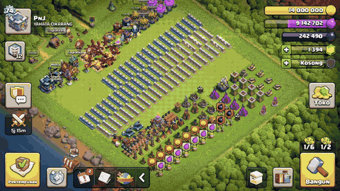
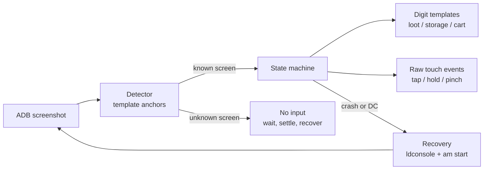
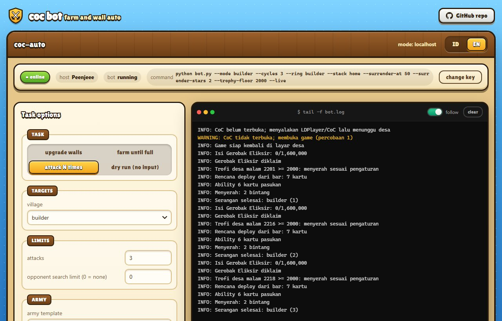
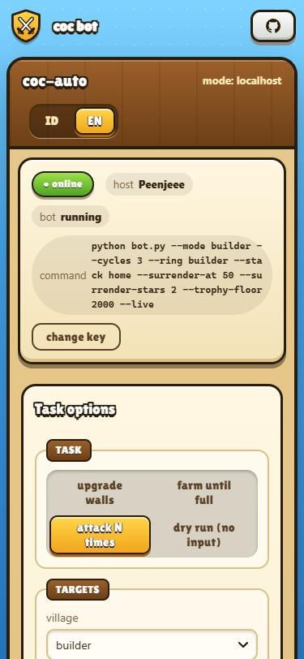
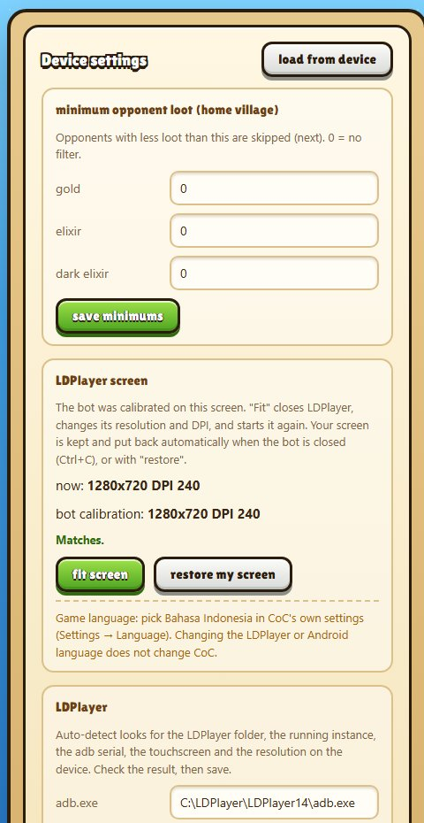
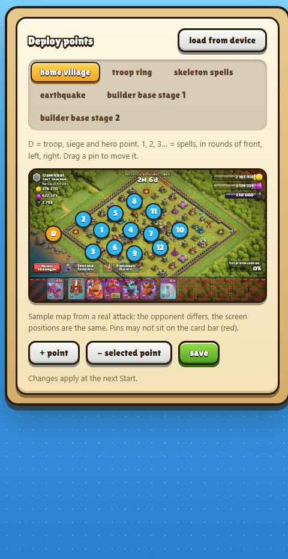

# CoC Auto — Clash of Clans farming bot for LDPlayer

A local Python bot that farms **Clash of Clans** on an **LDPlayer** emulator through ADB and OpenCV.
It attacks in both the **Home Village** and the **Builder Base**, filters opponents by loot,
claims rewards, and keeps going until both villages' gold and elixir storages are full —
reopening the emulator or the game by itself if anything closes or disconnects.



▶️ [Full-quality demo video (MP4)](docs/demo.mp4) · 🖥️ [Web dashboard](#web-dashboard)

> [!WARNING]
> Automating Clash of Clans violates Supercell's Terms of Service. **Your account can be banned.**
> There is no anti-ban or detection evasion. Use it only on an account you are willing to lose.
> The bot never buys anything, never spends gems, never upgrades anything but walls (and only with `--walls`),
> and never logs in for you.

---

## Features

| Area | What it does |
| --- | --- |
| **One command** | `python bot.py --until-full --live` starts LDPlayer if it is off, opens CoC, and farms. |
| **Self-recovery** | Restarts a stopped LDPlayer (`ldconsole`), waits for ADB after a disconnect, and reopens CoC after a crash. A stuck screen that tidying does not clear (search clouds that never go) restarts CoC, then LDPlayer. LDPlayer is restarted between attacks once its VM reaches 10 GB, and a run turns off its ASTC texture decoding, which doubles that growth. |
| **Home Village** | Searches opponents with a minimum gold / elixir / dark-elixir filter (unlimited searches by default). |
| **Deploy plan** | Reads the card bar on the scout screen, so it follows whatever army is trained: holds each troop card at the deploy point until it is empty, drops the siege machine, then the Grand Warden (found by its green ground/air toggle) and the other heroes, each followed by its ability, and throws the spells in rounds of front, left and right, each round further into the base so no two spells share a spot. |
| **Builder Base** | Reads the card bar too: drops the Battle Machine or Battle Copter and fires its ability, spreads one troop card per point around the base (one tap per unit for multi-unit camps such as Raged Barbarians), fires the troop abilities five seconds later and the hero's again whenever its meter is full, handles stage 2 (a stage 1 won while the surrender dialog is up has its stage 2 given up too), keeps fighting to the end while trophies are under `--trophy-floor`, and claims the **Elixir Cart** before every attack. |
| **Until full** | Attacks the Builder Base first, then the Home Village, and stops when gold and elixir are full in both. Capacity is read from the in-game storage tooltip, so it follows your Town Hall / storage level. |
| **Popups** | Star bonus, reward chest and reward card, the "defence layout blocked" warning, the inactivity and "another device" reloads, a lost connection, the game update offer, the Gold Pass offer and Google Play's "Rate this app" sheet are handled. Nothing is ever tapped on an unknown screen: the bot waits, settles and restarts the game, and stops after `--max-recoveries` without progress. |
| **Walls** | `--walls` spends stored gold and elixir on walls, cheapest level first, then farms both full and repeats until every wall is maxed. It never spends gems. |
| **Web dashboard** | Live log, a live view of the LDPlayer screen and full control from a phone or the PC, in a Clash-style look: start any command (army templates fill the options in), stop, open/close CoC, restart LDPlayer, set loot minimums, auto-detect LDPlayer, fit its screen, and move deploy pins over a real attack screen. Indonesian or English; the switch also sets the bot's terminal language. Installable as an app. |
| **Speed** | Taps go through raw touch events, the camera is followed until it stops moving, and the battle speed is switched to **4x**. |
| **Safety** | Every tap is gated on a recognised screen; dry-run (no `--live`) never sends input. A setup that cannot work (taps that cannot land, ADB debugging off, a loot minimum no opponent meets) stops the run with what to change. |

## Recommended armies

The bundled deploy plans were tuned for these armies. Other compositions work too, but deploy points and card order may need recalibration (see [Changing the army and deploy plan](#changing-the-army-and-deploy-plan)). The Home Village has two ways to attack:

| Village | Troops | Spells | Run with | How it attacks |
| --- | --- | --- | --- | --- |
| **Home Village** stack (default) | Full **Dragons** and/or **Electro Dragons** | Full **Rage** or full **Freeze** | nothing, or `--stack home` | Troops held at one edge point (`D`) until the card is empty, then the siege machine and heroes with their abilities, then the spells along the troops' path. |
| **Home Village** ring | **Valkyries / Super Valkyries**, **Barbarians / Super Barbarians**, **Super Minions** or full **Miners** | **Earthquake** (`--quake`) or **Skeleton** | `--ring home`, plus `--quake` for earthquakes | Heroes with their abilities first, the siege machine, then the spells (earthquakes four per wall pin, skeletons over the middle of the base), then the troops streaming out of eight fingers round the map edge. |
| **Builder Base** ring (default) | Full **Baby Dragons** or full **Raged Barbarians** + Battle Machine/Copter | — | nothing, or `--ring builder` | The hero and its ability, then every camp in one go, each on the next spread point round the base (a Raged Barbarian camp gets one tap per unit, `4x` = four). |
| **Builder Base** stack | Full **Witches** + Battle Machine/Copter | — | `--stack builder` | The hero and its ability, then every camp in one go on the deploy point `D`. |

`--ring` and `--stack` take `home`, `builder` or `both` (alone, `both`), so one `--until-full` run can attack each village its own way, e.g. `--ring home --stack builder` for Valkyries and Witches. By default every Home Village attack gives up at 50% damage (`--surrender-at 0` fights to the end) and every Builder Base attack gives up stage 1 at 2 stars, so stage 2 is never played (`--surrender-stars 0` fights on).

- **Rage and Freeze go with the default plan.** The ring plan drops the spells before the troops, so earthquakes open the walls and skeletons pull the defences before the troops walk in; Rage and Freeze need troops already on the field.
- **Valkyries + earthquakes are the fastest farm** in live tests: 37 Valkyries out in about 2 seconds and 50% reached about 17 seconds after the deploy began. 300 Barbarians + skeletons took 22–39 seconds, depending on the base. Super Valkyries, Super Barbarians, Super Minions and Miners use the same ring plan but have not been tested live yet.
- **Miners dig under the walls**, so they need no earthquakes: pair them with skeletons, or no spells.
- **Builder Base:** the Witch stack, the Baby Dragon ring and the Raged Barbarian ring were tested live, stage 2
  included. Camps that live through stage 1 spread again in stage 2. The hero's ability fires once more whenever the
  three steps of its meter are charged, as it is weaker before. `--trophy-floor 2000` fights every battle to the end
  while trophies are under 2000 and goes back to the 2-star surrender above it.
- The loot minimum is `0` by default, the fastest farm: every opponent is attacked as it comes, without reading its loot.
- Heroes and a siege machine are optional in both plans; the default plan's sweep step deploys any card left in the bar.
  Troops and spells are told apart by how the game groups the card bar (troops, siege machines, heroes, spells, with a
  wider gap between groups), not by card colour, so any troop type works, with or without heroes and a siege machine.

## How it works



- **Screens** are recognised by two or more small UI crops per screen (`anchors`), matched with OpenCV.
  A screen can have alternative anchor sets (`alt_anchors`) when it has two layouts, such as the win and loss result screens.
  The two villages are told apart by their elixir icons (pink in the Home Village, violet in the Builder Base), which
  every Town Hall and Builder Hall level shows, so a Town Hall below 7 (no dark elixir bar) is still the Home Village
  and never taken for the Builder Base.
  A search anchor that may sit anywhere in a wide region (the wall buttons) is matched at half size first, then at
  full size around the best spot, which keeps a screenshot's detection near 70 ms.
- **Numbers** (loot, storage bars, the "Maks" tooltip, the Elixir Cart, the battle's damage percent, the Builder Base
  trophies and the `xN` / `Nx` counts on the cards) are read with per-digit templates built from real screenshots.
  Several font variants per digit are supported. Builder Base stars and the hero's ability meter are read by colour.
- **Input** is sent as raw multitouch events written to `/dev/input/eventN`, which makes holds and pinches possible.

## Requirements

- Windows with **LDPlayer** (tested on LDPlayer 14, Android 14, **1280×720**, the game in Indonesian or English),
  or a Mac with Apple Silicon and **BlueStacks Air**, set up by one script (see [macOS](#macos-bluestacks-air))
- **Python 3.10+**
- ADB from LDPlayer (`adb.exe`) with **local ADB debugging** enabled in LDPlayer settings (the dashboard's "fit
  screen" turns it on)
- A **64-bit** LDPlayer (LDPlayer 9 or newer): touch input is written as 64-bit Linux input events
- Optional: Tesseract OCR — only a fallback when digit templates are not configured

The account:

- A **Dark Elixir Storage** (Town Hall 7+) only for dark elixir (`--dark`, `--home dark`). `--walls home` works with
  or without one: without a dark elixir bar the gem bar moves up into its row, and the bot finds it by its green gem
  icon before every wall session (no gem icon, no upgrade).
- **Builder Base unlocked** for the default `--until-full` and for `--builder`/`--walls builder`; without it use
  `--home`.
- A loot `minimum` and `walls.home.gold_reserve` that fit the Town Hall (see
  [First-time setup](#first-time-setup-for-another-pc-or-account)).

## Installation

```bash
git clone https://github.com/peenjeee/coc-auto.git
cd coc-auto
python -m pip install -r requirements.txt
```

Enable ADB in LDPlayer (**Settings → Other settings → ADB debugging → Open local connection**) and check the device:

```bash
C:\LDPlayer\LDPlayer14\adb.exe devices
```

> [!IMPORTANT]
> The bundled calibration was built and tested with the game language set to **Bahasa Indonesia** or
> **English** on LDPlayer at **1280×720**. Screens are recognised from on-screen text and icons, so another
> language, resolution, UI scale, or army layout will not match out of the box.
> If the bot stops with *"Layar tidak dikenal"* (*"Unknown screen"* with `"language": "en"`) or taps the wrong place,
> recalibrate it for your own setup — see [Calibration](#calibration).

### macOS (BlueStacks Air)

On a Mac with Apple Silicon, `scripts/bsair.sh` does the whole setup: it turns on ADB in BlueStacks Air, starts it,
sets the screen to 1280×720 at DPI 240, finds the touch device and writes `config.local.json` for this Mac.

```bash
git clone https://github.com/peenjeee/coc-auto.git
cd coc-auto
scripts/bsair.sh deps    # a .venv with Python 3.12 and requirements.txt
scripts/bsair.sh all     # ADB on, BlueStacks started, screen fitted, config.local.json written
```

Then start the bot through the script instead of `python bot.py`; it takes the same options and fits the screen
again first, since BlueStacks forgets it on every restart:

```bash
scripts/bsair.sh bot --until-full --home all --live
```

The dashboard works the same, on `http://localhost:8765`. Run `scripts/bsair.sh all` again after a BlueStacks
update or a Mac restart. Differences from LDPlayer: taps go through `input tap` (CoC ignores raw touch on
BlueStacks Air), so there is no pinch zoom and ring attacks tap instead of streaming; the LDPlayer controls (fit
screen, LDPlayer restart, the memory restart) are off; and the calibration comes from LDPlayer, so a screen may need
recalibrating. Every command, what the script changes and the known limits are in
[scripts/README.md](scripts/README.md).

## First-time setup for another PC or account

The bundled `config.json` was made on one PC for one account. Before the first live run on yours, check each
row below. Everything here is either an LDPlayer setting or a config key. Put your own values in
**`config.local.json`** next to `config.json`, with only the keys you change (for example
`{"serial": "emulator-5556", "ld_index": 1, "minimum": {"gold": 200000}}`). It is read on top of `config.json`, is
not in git, so `git pull` never collides with it, and the dashboard saves its settings and moved deploy pins there.

| What | Must be | Why / how to check |
| --- | --- | --- |
| LDPlayer resolution | **1280×720, DPI 240**, set for you | Screens are matched pixel for pixel, and text renders differently at another size or DPI. A live run on any other screen (such as LDPlayer's default 1920×1080, DPI 280) switches the instance to 1280×720, DPI 240 first, when `ldconsole` is set (LDPlayer restarts once, waiting until its virtual machine has let go of the disks), and puts your own screen back when a `--no-remote` run exits; under the dashboard it goes back when you leave the dashboard link. "Fit screen" in the dashboard does the same by hand. The calibrated DPI can be changed with the optional `dpi` key (default 240). |
| Game language | **Bahasa Indonesia** or **English** (a few rare popups not recognised yet) | Many anchors are text ("Pertempuran"/"Battle", "Tembok"/"Wall", "Maks:"/"Max:"). Each template with text has an English twin under the same file name in `calibration/en/`, tried after the Indonesian one; a few English-only anchors cover labels whose box differs ("Upgrade time", "Battle starts in", "Defender", "Battle ends in"). Popups that could not be brought up on purpose (rewards, league, gem offer, all builders busy, update offer) are calibrated in Indonesian only; the Gold Pass offer is told by its X button and shield alone, so it needs no
language. The Builder Base scout screen is also recognised when Android's status bar covers the top of the screen, as it can after an LDPlayer restart. A home battle is also recognised by its "Surrender" button and "Overall Damage" label alone: the loot icons and "Battle ends in" show the map through them and miss on a bright base. With another language every text anchor has to be recalibrated. Set it in CoC's own settings (Town Hall icon top left → Settings → Language): CoC keeps its own language, so changing Android's or LDPlayer's language does not change it. |
| `adb`, `ldconsole` | Paths in your LDPlayer install folder | e.g. `C:\LDPlayer\LDPlayer14\adb.exe` and `C:\LDPlayer\LDPlayer14\ldconsole.exe`; the folder name depends on the LDPlayer version. |
| `ld_index`, `serial` | Your instance | `ld_index` is the instance number in LDMultiPlayer (0 for the first). `serial` is `emulator-<5554 + 2 × index>`: `emulator-5554` for index 0, `emulator-5556` for index 1. Check with `adb devices`. |
| `touch_device`, `zoom_out.device` | The touchscreen node | Run `adb -s <serial> shell getevent -pl` and use the `/dev/input/eventN` whose block lists `ABS_MT_POSITION_X`. Set both keys to it; holds, pinches and fast taps go there. |
| `minimum` | `0` (the default), or a loot filter that fits your Town Hall | `0` attacks every opponent as it comes without reading its loot, the fastest farm. To skip poor bases, `500000` gold and elixir suits high Town Halls; set it lower for a low Town Hall, or every opponent is skipped. `0` turns a resource off. If searching runs out of gold 3 attacks in a row, the bot stops (exit code 6) and asks you to lower it. |
| `walls.home.gold_reserve` | Gold kept for searching | `200000` by default; lower it for a low Town Hall whose gold storage is small, or gold wall upgrades never pass it. |
| `tesseract` | Only when `digits` is not set | Loot is read with the digit templates in `calibration/digits`. Tesseract is needed only if you remove `digits`. |

The LDPlayer rows (`adb`, `ldconsole`, `ld_index`, `serial`, `touch_device`) can also be filled from the
[web dashboard](#web-dashboard): **auto-detect** under device settings finds the LDPlayer folder, the running instance,
its adb serial, the touchscreen node and the screen size, and lists anything that does not fit (for example a
resolution other than 1280×720). Check the result and press save. `minimum` can be set there too.

Then open the village and run the dry run, which sends no input:

```bash
python bot.py
```

It should log `Dry-run: layar=home` (or `builder`; `Dry-run: screen=home` with `"language": "en"`). *"Layar tidak dikenal"* means the screen does not match; recheck
resolution, DPI and language before recalibrating anything. Like every command, it then stays on standby for the
dashboard; leave with **Ctrl+C**, or run `python bot.py --no-remote` to exit right after the check.

## Quick start

The repository ships with the calibration that was used to build and test the bot (`config.json` + `calibration/`).
If your setup matches (see [First-time setup](#first-time-setup-for-another-pc-or-account)), you can start right away:

```bash
python bot.py --until-full --live
```

The fastest farm, with a Valkyrie + earthquake army (see [Recommended armies](#recommended-armies)): heroes and
earthquakes first, Valkyries round the base, and give up at 50% damage:

```bash
python bot.py --until-full --ring --quake --surrender-at 50 --live
```

With skeletons instead of earthquakes, leave out `--quake`. On the web dashboard, the **army template** list fills in
these options for each recommended army (Valkyries + earthquakes, Barbarians + skeletons, dragons, Miners +
skeletons, Super Minions), and the **Builder Base army template** list does the same there (Baby Dragons spread,
Witches on one point, Raged Barbarians spread); they can still be changed by hand afterwards.

| Command | Purpose |
| --- | --- |
| `python bot.py` | Dry run: detect the current screen and, on a scout screen, read loot. No input. |
| `python bot.py --mode builder --cycles 1 --live` | One Builder Base attack. |
| `python bot.py --mode home --cycles 1 --live` | One Home Village attack. |
| `python bot.py --mode both --cycles 3 --live` | Alternate villages, three rounds. |
| `python bot.py --until-full --live` | Farm until both villages are full, with self-recovery. |

### Choosing what to fill

`--builder` and `--home` pick the village and the resources to fill. Each takes a comma-separated list or `all`,
and either one alone farms only that village. Without both, `--until-full` fills Builder Base gold, elixir and the
Elixir Cart, then Home Village gold and elixir. Add `--dark` to fill Home Village dark elixir as well:

```bash
python bot.py --until-full --dark --live
```

| Village | Resources | `all` means |
| --- | --- | --- |
| `--builder` | `gold`, `elixir`, `cart` (Elixir Cart) | `gold,elixir,cart` |
| `--home` | `gold`, `elixir`, `dark` (dark elixir) | `gold,elixir,dark` |

```bash
python bot.py --builder gold --live
```
```bash
python bot.py --builder elixir,cart --live
```
```bash
python bot.py --home gold,dark --live
```
```bash
python bot.py --builder all --home all --first home --live
```

The first command fills Builder Base gold only, the second Builder Base elixir and the Elixir Cart, and the third
Home Village gold and dark elixir. The last fills everything in both villages, Home Village first. Use
`--home gold,elixir` instead of `--home all` to leave dark elixir out. A resource must be calibrated before it can
be chosen (dark elixir needs a `capacity.home.dark` entry); the bot refuses to start otherwise. If the Elixir Cart
cannot be found on 5 Builder Base visits in a row, its fill cannot be read, so `cart` counts as done for the rest of
the run instead of keeping the bot attacking forever.

### Upgrading walls

```bash
python bot.py --walls home --live
```
```bash
python bot.py --walls both --first home --live
```
```bash
python bot.py --walls home --hours 3 --live
```
```bash
python bot.py --walls home --max-upgrades 20 --minutes 45 --live
```
```bash
python bot.py --walls both --bulk-walls --live
```
```bash
python bot.py --walls home --wall-resource elixir --wall-every 5 --live
```

`--walls` takes `home`, `builder` or `both`. For each village in turn it first spends the gold and elixir already
in storage: it opens the builder list, finds a "Tembok" row ("Wall" in an English game; the row template follows the
list's own language, so the Grand Warden's "Wali Besar" is never taken for a wall), and upgrades one wall at a time
with whichever of gold or elixir is still affordable. It always takes the lowest wall level first, and moves on to the next level only when that one is used up. Each wall level costs more than the one below, so it reads the price on every wall row and picks the cheapest. Position in the list says nothing about level: the game puts affordable rows above ones the storage cannot pay for. When neither resource is affordable any more, it
farms until gold and elixir are both full, spends them again, and repeats. It stops once no "Tembok" row is left, which means
every wall is at the maximum level for the current Town Hall or Builder Hall. In the Builder Base it also claims the
Elixir Cart first; its lower walls cost gold only, higher ones gold or elixir (gold first, like the Home Village), and only the upgrade buttons a wall actually shows are used. Builder Base walls also need a free builder: with every builder busy the game offers to free one for gems, and the bot closes that offer with X and skips the Builder Base walls for that run. If storage is full and still no wall can be upgraded, the run stops instead of looping. `--first` picks the village to finish first when `both` is chosen.
`--wall-resource gold` or `elixir` pays for walls with that resource only and farms only it full; a wall that the chosen
resource cannot pay for (such as a low Builder Base wall, gold only, with `elixir`) is never upgraded, and once the
storage is full with no wall that resource can pay for, the run stops. `--wall-every N`
goes back to the walls after N attacks, or sooner once the storage is full, so walls get the loot without waiting for a
full storage; a short round that leaves nothing affordable just farms on.
The bot never spends gems. It taps an upgrade only when its price is shown in white, and taps Konfirmasi only when
the dialog is a wall upgrade, its price is white, and its icon is the chosen gold or elixir. During a sale such as
Hammer Jam the Home Village dialog changes: the button carries a "Konfirmasi" label, the new price is green and the old
one is struck through in white below it. The bot knows this layout by the label (`walls.home.confirm.sale`) and then
counts only the green price, so a sale price the storage cannot pay (shown in red) is never confirmed even though the
struck-through price is white; the icon must still be gold or elixir. The gold reserve is checked against that green
price too, so gold keeps paying for walls during a sale.

With `--bulk-walls` the selected wall's "Tingkatkan Lebih Banyak" ("Upgrade More") button upgrades many walls of its
level in one go (`walls.<village>.bulk`). The button is found by its label, since the wall drawn on it is the selected
wall's level. The bot adds ten walls at a time while the price stays white, then takes one off at a time until it is
white again (one at a time when +10 is greyed out, or gone: with only a few walls of that level left the bar shows -1
and +1 only), never beyond `--max-upgrades` or, for gold, the gold reserve. The dialog that follows ("Yakin ingin
meningkatkan tembok yang dipilih dengan … Emas?", in English "… for … Gold?") gets Oke only when it names the chosen
resource (Emas/Gold, Eliksir/Elixir, or their "Tukang" Builder Base forms), so a gem price is never confirmed; anything
else is cancelled with Batal. A wall without the button, or a
resource that pays for one wall only, takes the one-wall upgrade. When the button lights up more walls but the -1/+10/+1
bar never comes (the plain wall panel stays, as with the last few walls left to max), the run stops using it and goes
on one wall per upgrade. The bulk selection outlives the builder list, so the
bot clears it by opening and closing the list. With wall rings (both villages) the ring adds a button, and beside the
open builder list the buttons wrap into two rows: "Tingkatkan Lebih Banyak" ends the top row, and in bulk mode -1,
+10 and +1 sit above the upgrade buttons instead of left of them; the bot reads both layouts. A bulk bar it cannot
place them in is left untouched and the rest of that run goes one wall at a time. Wall rings are never used. It reads the gem count
before and after every upgrade and keeps the last trusted count across recoveries. A count that drops with the same
number of digits stops the run for good, without any recovery. A count with other digits or a higher one is treated
as a misread: nothing is tapped and recovery reads it again. In the Home Village it also keeps a gold reserve (`walls.home.gold_reserve`, 200,000) for opponent searches, which cost gold: a gold upgrade that would dip below it is closed and that session continues with elixir. A village needs a
`walls.<village>` calibration before `--walls` accepts it.

### CLI options — `bot.py`

| Option | Default | Description |
| --- | --- | --- |
| `--config PATH` | `config.json` next to `bot.py` | Calibration file to use; `config.local.json` beside it is read on top. |
| `--mode {home,builder,both}` | `both` | Villages used by `--cycles` runs. |
| `--cycles N` | `1` | Rounds to attack (1–100). |
| `--searches N` | `0` | Opponent searches per Home attack; `0` means unlimited. At the limit the base on screen is attacked whatever its loot, so the run never stops for want of a good base. |
| `--until-full` | off | Attack until gold and elixir are full in both villages. |
| `--dark` | off | With `--until-full` (and no `--builder`/`--home`): fill Home Village dark elixir too. |
| `--builder RESOURCES` | – | Fill these Builder Base resources (`gold`, `elixir`, `cart`, or `all`). Implies `--until-full`. |
| `--home RESOURCES` | – | Fill these Home Village resources (`gold`, `elixir`, `dark`, or `all`). Implies `--until-full`. |
| `--first {builder,home}` | `builder` | Which village to work on first when both are chosen. |
| `--walls {home,builder,both}` | – | Spend the stored gold and elixir on walls, then farm both full and repeat until every wall is maxed. Never uses gems. |
| `--hours N`, `--minutes N` | `0` | Stop `--until-full`/`--builder`/`--home`/`--walls` after this long; the two add up (`--hours 1 --minutes 30` is 90 minutes). The attack or upgrade in progress is finished first, then the run ends in the village with exit code 0. `0` means no limit. With `--until-full`/`--builder`/`--home` it needs `--live`. |
| `--max-upgrades N` | `0` | `--walls` only: stop in the village after N walls are upgraded. `0` means no limit. |
| `--bulk-walls` | off | `--walls` only: upgrade many walls of the picked level with one Oke through "Tingkatkan Lebih Banyak", as many as the resource pays for, instead of one at a time. Both villages. |
| `--wall-every N` | `0` | `--walls` only: go back to the walls after every N attacks instead of waiting for full storage. `0` waits until full. |
| `--wall-resource gold\|elixir\|both` | `both` | `--walls` only: pay for walls with gold only, elixir only, or both (gold first). Farming then fills only that resource. Both villages. |
| `--surrender home\|builder\|both` | off | Give up a battle in these villages that is still running `--surrender-after` seconds into it, counted from the start of the deploy and checked during the deploy too (like `--surrender-at`), so the rest of the army stays home: taps **Menyerah**/**Akhiri Serangan**, then **Oke**. In the Builder Base it counts per stage, so giving up stage 1 skips stage 2. |
| `--surrender-after N` | `60` | Battle seconds, 1–120. On its own (without `--surrender`) it turns surrendering on in both villages. The battle clock runs at normal speed until its last minute (when the 4x button appears), so past 120 there is little left to save. |
| `--surrender-at P` | `50` | Home Village: surrender once the battle's **Total Kerusakan** reads P percent (0–99) twice in a row, checked during the deploy too, so the rest of the army stays home. `0` never surrenders. Works with `--surrender-after`; whichever comes first. A setup without the damage calibration farms on without it (a warning says so) unless the option is given. |
| `--surrender-stars N` | `2` | Builder Base: give up stage 1 once its damage box shows N gold stars (0–3) twice in a row, checked during the deploy too; a stage 2 reached anyway is ended from its own screen without deploying. `0` fights on, stage 2 included. |
| `--trophy-floor N` | `0` (off) | Builder Base: before each attack read the trophy count on the village screen. Under N the battle is fought to the end with no surrender, stage 2 included, to win trophies back; at or over N it surrenders as set again. An unreadable count keeps the setting. |
| `--stack [home\|builder\|both]` | home | Troops on the one deploy point `D`. Home Village: the default dragon plan. Builder Base: the hero and its ability, then every camp on `D` (full Witches). |
| `--ring [home\|builder\|both]` | builder | Builder Base: every camp in one go, each on the next spread point (the default). Home Village fast attack: every hero dropped at `D` then each ability, the siege machine, the spells (skeletons over the middle of the base, eight at once, one per finger), then each troop card streaming out of eight fingers held at once on ring pins round the map edge, moving one pin on each second until the card greys out. Without a touch device the troops are tapped instead, exactly the `xN` count read from the card. |
| `--quake` | off | Home Village: the spells go four on each quake pin in turn (four earthquakes break the walls there), one per finger, at most the `xN` count read from the card. |
| `--max-recoveries N` | `20` | How many recoveries (restarting LDPlayer or CoC, settling a stalled screen) a `--live` run (`--until-full`, `--walls` or `--cycles`) may make without progress. The count starts again after every finished attack or upgraded wall. |
| `--live` | off | Allow real taps. Without it the bot only observes. |
| `--agent` | off | Run no task: show the device's API key and wait for **Start** from the web dashboard. |
| `--key` | off | Only show this PC's API key and the dashboard addresses, then exit. Nothing is started. |
| `--no-remote` | off | Run the task without the dashboard link and exit when it ends (the behaviour before the dashboard). |
| `--new-key` | off | Make a new dashboard API key for this PC; the old one stops working. |

Every command runs under the [web dashboard](#web-dashboard) link: when its task ends (or is stopped), the bot stays on
standby for the dashboard. Leave with **Ctrl+C** at any time. However the bot stops (Ctrl+C, the dashboard's stop, or
an error), it lifts every virtual finger it may have held, so a hold or zoom cut short does not leave the game reading
your own drags as a pinch. A run also lifts them before its first tap, for a bot that was killed without that chance.

## Web dashboard

Every `bot.py` command prints this PC's **API key** (made once, kept in `~/.coc-auto/device.json`) and serves the
dashboard (open the address it prints in a browser). Enter the key there to follow the terminal log live and control the bot:

- **Local:** `http://localhost:8765`, served by the bot itself (works without internet).
- **Online:** `https://coc.0xpnj.dev`, for checking from a phone. The PC connects out to an online relay channel
  named after a hash of the key, so no router port has to be opened.



<p>
  
  
  
</p>

The pictures are the dashboard's own preview, with sample data: add `?preview=1` to its address to look around
without a device.

▶️ [Dashboard walkthrough video (MP4)](docs/dashboard.mp4), recorded on the local dashboard with LDPlayer: connecting
with the key, the live view and its switch, one Builder Base attack started from the dashboard (sped up 8×), then
Stats, the deploy pins on every map, LDPlayer auto-detect, Discord notifications and the switch to Indonesian.

You can open the dashboard locally, or online when you are out or away from the PC. For online use, the PC that runs
the bot must stay connected to the internet. Open [coc.0xpnj.dev](https://coc.0xpnj.dev) and enter the API key of the
PC that runs the bot; the key is printed in the terminal when the script starts.

> **ID:** Anda dapat membuka web lokal maupun online jika sedang di luar atau jauh dari perangkat. Pastikan perangkat
> yang menjalankan bot terhubung ke internet. Pantau lewat [coc.0xpnj.dev](https://coc.0xpnj.dev) dengan memasukkan
> API key dari perangkat yang menjalankan bot; key itu tampil di terminal saat script dijalankan.

The online dashboard installs as an app (PWA): press **install app** in its header or use the browser's own menu
(Install, or Share → Add to Home Screen on a phone). It opens
in its own window with the bot's icon; without a connection it still opens, and shows the PC as offline.

To run everything from the web without starting a task first:

```bash
python bot.py --agent
```

It shows the key and waits for **Start** from the dashboard. `python bot.py --key` only shows the key and exits; the
dashboard can control the PC only while `--agent` (or any other bot command) is running there.

The dashboard (Indonesian or English, switch in the title bar; the switch also sets the bot's terminal language,
`language` in config, and on connecting the dashboard puts the device on the language it is shown in) has four
pages. **Overview** shows whether the PC is online, the bot's state, run time, task and recoveries, the run setup,
a **Live view** of the LDPlayer screen and the **Activity** log. The live view is captured only while the page is
open and in view and its switch (in the panel's title, on by default) is on, once a second on the local and the
online dashboard (online, each frame crosses the relay); every frame replaces the last and none is stored. With the
switch off, **Refresh** still takes one frame. **Stats**, **Deployment** and **Device settings** are below. The run setup
covers every command above: the task, villages, resources to spend or fill, the Home Village loot minimum and
`--first`, then **Run limits** (`--bulk-walls`, attacks, searches, time, upgrades, `--wall-every`, recoveries),
**Army & deployment** (the army templates, ring or stack per village, `--quake`) and **Battle behavior**
(surrender: damage, stars, trophy floor, time). It shows the equivalent `python bot.py ...` line; **Start** runs it
(a running task is stopped first). Other buttons: stop bot, repeat the last command, open CoC, close CoC, restart
LDPlayer, turn LDPlayer off; the last three stop the bot first. When the PC is off, offline or the bot is not
running, the dashboard says so instead of sending, and a command that gets no answer within 10 seconds is reported.
Recovery and `settle` work as before: the task runs as a child process (`--worker`) of the dashboard link.
The language switch updates live logs, recent log history, setup problems and visible notifications immediately,
without restarting the task. It changes display text only; CoC's language and screen detection are independent.

**Stats:** resource gains, completed attacks, wall upgrades (bulk upgrades included), recoveries, run time, attacks
per hour, run history and activity charts, for this run, 24 hours or 7 days. Home Gold/Elixir and Builder Gold/Elixir
are counted apart. The numbers come from the task's own log and are kept in `.coc-auto/stats.sqlite3` next to the
config, so closing the browser does not reset them. Resources are **measured storage increases**, never the loot
offered by a scouted opponent: the first reading is a baseline, a resource that was never read stays blank, and full
storages or spending between readings can hide gains.

**Discord notifications** (Device settings, local dashboard only): paste a Discord webhook URL, optionally your
numeric Discord user ID for pings, pick the events (run started, run ended, recovery, progress report every 15, 30 or
60 minutes), enable and save; **Send test** checks the saved webhook. The URL is kept in `.coc-auto/discord.json`,
never shown back in the dashboard and never sent through the online relay; only `discord.com` webhook URLs are
accepted, and only the given user ID is ever mentioned. Messages go out from a small background queue, so the game
never waits on Discord; recovery messages have a one-minute cooldown.

**Deploy points:** the deploy pins of the Home Village and both Builder Base stages are loaded when the dashboard
connects and drawn over a real attack screen of each (`web/maps/`), or over the last screenshot the bot took of
that deploy screen on this PC (taken while attacking, kept in `captures/`). Drag pins to
move them, add or remove numbered pins, and save: `D` is the deploy point (troops, siege and heroes; the Battle
Machine/Copter), the numbered pins are the Home Village spell points (rounds of front, left, right) or the Builder
Base points, one per troop card. Three more Home Village tabs move the `--ring` pins round the map edge (troops),
the spell pins over the middle of the base (skeletons, `--ring` without `--quake`) and the `--quake` pins on the
walls at the base top, right, bottom and left. Pins cannot go on the card bar. The device checks them like any calibration,
writes them to `config.local.json` (the previous one stays as `config.local.json.bak`; `config.json` is never
rewritten), and they apply at the next Start.

**Device settings:** loaded when the dashboard connects. *Minimum opponent loot* sets the Home Village gold, elixir
and dark elixir filter (`minimum`; `0` = no filter). *LDPlayer* holds `adb`, `ldconsole`, `serial`, `ld_index` and
`touch_device`; **auto-detect** fills them from what it finds on the PC (it only reads: `ldconsole list2`,
`adb devices`, `getevent -pl`, `wm size`) and lists problems, such as LDPlayer being off or a wrong resolution.
Nothing changes until you press save. The device accepts only LDPlayer's own `adb.exe` and `ldconsole.exe` as
paths, checks the rest like any calibration, saves to `config.local.json` (the previous one stays as
`config.local.json.bak`), and the change applies at the next Start.

**LDPlayer screen:** shows the instance's resolution and DPI next to the calibration (1280×720, DPI 240). "Fit
screen" stops the bot, closes LDPlayer, waits for its virtual machine to stop, writes only the resolution, the DPI,
ADB debugging (turned on) and ASTC texture decoding (turned off) into its instance file
(`vms\config\leidian<index>.config`; `ldconsole modify` is never used because it drops other settings) and starts
LDPlayer again. A live run does the same by itself on any other screen, with ADB debugging off or with ASTC on. With
ASTC on, LDPlayer's VM grows about twice as fast while CoC battles (+4.6 GB in 30 minutes of farming against +2.2 GB
with it off); CoC looks the same either way. Restoring your screen leaves ADB debugging on and ASTC off.
Your own resolution and DPI are kept in `~/.coc-auto/display.json` and are put back when you leave the dashboard link
with **Ctrl+C**, when a `--no-remote` run ends, or with "restore my screen". LDPlayer is restarted for a restore only
if it is running.

Security: commands are signed with the API key (HMAC-SHA256, valid for 2 minutes, never reused, never older than
the running bot), and everything the PC sends online is signed with it too, so nobody else on the channel can pose
as the device or as the dashboard. The key itself never leaves the browser or the PC, and the page loads no
third-party code: even its font, Lilita One, is served from `web/fonts/` (SIL Open Font License, `web/fonts/OFL.txt`). Only the options the CLI offers are accepted. The local dashboard listens on 127.0.0.1 only and
refuses other sites (Host, Origin and JSON checks). Use `--new-key` if the key was shared by mistake.

The online relay is already set up (`remote` in `config.json`, and `web/config.js`); there is nothing to configure
for online use.

## Calibration

| Files | UI version |
| --- | --- |
| `config.json` + `calibration/` | Current game UI (after the latest update). |
| `config.legacy.json` + `calibration-legacy/` | Previous game UI, kept for reference. Run it with `python bot.py --config config.legacy.json`. |

Calibration is specific to resolution, language, UI scale, and army composition. After a game update, or on a
different setup, recalibrate the screens that are no longer recognised. Calibration only works on screenshots and
never taps the game.

#### `calibrate.py` options

| Option | Meaning |
| --- | --- |
| `--config PATH` | Config to write (default `config.json` next to `calibrate.py`; only this shared file is written, never `config.local.json`). |
| `--init` | Create a new config; never overwrites one that exists. Needs `--serial`. |
| `--serial SERIAL` | ADB serial for `--init`, e.g. `emulator-5554` (see `adb devices`). |
| `--adb PATH` | `adb.exe` for `--init` (default `C:\LDPlayer\LDPlayer14\adb.exe`). |
| `--tesseract PATH` | Tesseract for `--init`; only needed when no digit templates are used. |
| `--gold N`, `--elixir N`, `--dark N` | Loot minimums written by `--init` (`0` = no filter). |
| `--capture PNG` | Save the current LDPlayer screen to a new PNG (never overwrites). |
| `--screen NAME` | Calibrate one screen (names below), from the live LDPlayer screen or from `--image`. |
| `--image PNG` | Calibrate from a saved screenshot instead of the live screen. |
| `--replace` | Recalibrate a screen that already exists: new anchors and tap points, everything else kept. |
| `--counts N …` | Units per troop card, left to right; needed the first time a deploy screen is calibrated. |
| `--learn-digits PNG:GOLD:ELIXIR …` | Build loot digit templates from scout screenshots labelled with the loot they show. |
| `--digits-dir DIR` | New folder for `--learn-digits` (default `calibration/digits`; it must not exist yet). |

#### General commands

Start a new config (first time on a new setup):

```bash
python calibrate.py --init --serial emulator-5554 --gold 500000 --elixir 500000 --dark 0
```

Save the screen LDPlayer shows now, to calibrate from later:

```bash
python calibrate.py --capture shot.png
```

Calibrate a screen from the live LDPlayer screen, from a saved screenshot, or again after a game update:

```bash
python calibrate.py --screen home
```
```bash
python calibrate.py --screen home --image shot.png
```
```bash
python calibrate.py --screen home --image shot.png --replace
```

Build digit templates from two or more labelled scout screenshots (gold and elixir as shown on screen):

```bash
python calibrate.py --learn-digits scout1.png:1234567:987654 scout2.png:450210:399870 --digits-dir calibration/digits-new
```

Use the legacy calibration with any command by adding `--config config.legacy.json`.

For each screen, the tool asks for two anchors (small, fixed pieces of UI that only that screen shows; not numbers,
timers or the base), then each tap point the screen needs. Deploy screens also ask for the deploy point and one slot
per `--counts` value, and `home_scout` asks for the gold, elixir and dark elixir loot numbers. An existing screen
needs `--replace`, which keeps everything else it has (`targets`, `auto`, `sweep`, `overrides`, `alt_anchors`,
`deploy`, `troops`, `loot`); tap points that a target already finds are not asked again.

#### Every screen

Open the screen in CoC, then run its command (add `--replace` if it is already calibrated, or `--image shot.png` to
use a saved screenshot). "Taps" are the points the tool asks for.

**Villages and attacks**

| Command | Screen | Taps |
| --- | --- | --- |
| `python calibrate.py --screen home` | Home Village | attack, switch (boat) |
| `python calibrate.py --screen home_menu` | Home attack menu ("Pertempuran") | find, close |
| `python calibrate.py --screen home_army` | Army screen before searching | attack, close |
| `python calibrate.py --screen home_scout --counts 1 1` | Opponent shown, before deploying | next; deploy point, card slots, loot numbers |
| `python calibrate.py --screen home_battle` | Home battle in progress | surrender (optional, for `--surrender`) |
| `python calibrate.py --screen home_result` | Home battle result | return |
| `python calibrate.py --screen builder` | Builder Base | attack, switch (boat), cart |
| `python calibrate.py --screen builder_menu` | Builder Base attack menu | find, close |
| `python calibrate.py --screen builder_scout --counts 1 1` | Builder Base stage 1, before deploying | deploy point, card slots |
| `python calibrate.py --screen builder_battle` | Builder Base stage 1 in progress | surrender (optional, for `--surrender`) |
| `python calibrate.py --screen builder_stage2 --counts 1 1` | Builder Base stage 2, before deploying | deploy point, card slots |
| `python calibrate.py --screen builder_battle2` | Builder Base stage 2 in progress | surrender (optional, for `--surrender`) |
| `python calibrate.py --screen builder_result` | Builder Base battle result | return |
| `python calibrate.py --screen builder_cart` | Elixir Cart window | claim, close |
| `python calibrate.py --screen loading` | Game loading screen | – |

**Popups**

| Command | Screen | Taps |
| --- | --- | --- |
| `python calibrate.py --screen star_bonus` | Home star bonus | ok |
| `python calibrate.py --screen builder_star_bonus` | Builder Base star bonus | ok |
| `python calibrate.py --screen reward_chest` | Reward chest | open |
| `python calibrate.py --screen reward_card` | Reward card | continue |
| `python calibrate.py --screen layout_blocked` | "Defence layout blocked" warning | ok |
| `python calibrate.py --screen league` | League popup | close |
| `python calibrate.py --screen welcome` | Welcome back popup | ok |
| `python calibrate.py --screen idle` | "Ada orang di sana?" (inactive) | reload |
| `python calibrate.py --screen update_offer` | "Pembaruan Tersedia!" (update offer) | update (the game's update button) |
| `python calibrate.py --screen disconnected` | "Sambungan terputus" / "Kesalahan sambungan" | retry |
| `python calibrate.py --screen search_failed` | "Tidak dapat menyerang desa! Coba lagi nanti." | close |
| `python calibrate.py --screen gem_offer` | "Perlu lebih banyak …" (resources for gems) | close (the X, never the gem button) |
| `python calibrate.py --screen other_device` | "Perangkat lain tersambung ke desa ini" | reload |
| `python calibrate.py --screen surrender_confirm` | "Akhiri Pertempuran?" (Batal / Oke) | confirm (the Oke button) |
| `python calibrate.py --screen builders_busy` | "Semua tukang sibuk!" | close (the X) |

**Walls**

| Command | Screen | Taps |
| --- | --- | --- |
| `python calibrate.py --screen build_list` | Builder list ("Tembok" rows) | close |
| `python calibrate.py --screen wall_selected` | A wall selected, upgrade buttons shown | close, build |
| `python calibrate.py --screen wall_confirm` | Home Village wall upgrade dialog | confirm, close |
| `python calibrate.py --screen builder_wall_confirm` | Builder Base wall upgrade dialog | confirm, close |
| `python calibrate.py --screen wall_bulk_confirm` | Bulk upgrade dialog ("Yakin ingin meningkatkan tembok yang dipilih …"), needed by `--bulk-walls` | confirm (Oke), close (Batal) |

The `--counts` values are the units on each troop card, left to right (for example `--counts 11 4` for 11
dragons and 4 rage spells); with an `auto` card-bar plan they are only used for the first calibration. The wall
details beyond these screens (price band, row template, gem count areas, confirm checks), storage bars, digit
folder and zoom settings are keys in `config.json`; see the configuration reference below.

### Changing the army and deploy plan

The army and how it is deployed live in `config.json`; no code changes are needed.

| Village | Key |
| --- | --- |
| Home Village | `screens.home_scout.auto` (reads the card bar; takes precedence over `troops`), plus `screens.home_scout.sweep` |
| Builder Base, stage 1 | `screens.builder_scout.auto` (reads the card bar; takes precedence over `troops`) |
| Builder Base, stage 2 | `screens.builder_stage2.auto` (reads the card bar; takes precedence over `troops`) |

A deploy screen with an `auto` entry builds its plan from the cards in the bar on every attack, once two frames in a
row show the same cards, so a new army needs no slot changes; its `troops` list is then ignored. In the Home Village
`auto` has three fields:

| Field | Meaning |
| --- | --- |
| `bar` | `[x, y, width, height]` of the card bar. |
| `hold` | Seconds each troop card is held at the screen's `deploy` point; it stops early once the card is grey. |
| `spells` | Spell drop points, listed as rounds of front, left and right, each round further into the base. |

In the Builder Base `auto` has `bar` and `points` instead. Troop cards carry a magenta header, or a dark blue one for
the camps that lived through stage 1, and a white slot number top left; hero cards (Battle Machine, Battle Copter)
have neither. Each hero is dropped at the screen's `deploy` point and then tapped again for its
ability. One tap deploys a whole troop camp, so each troop card is tapped once, at the next point of `points` in
turn; cards greyed out in stage 1 are skipped. A camp of several units (Raged Barbarians) shows an `Nx` label top
right instead and gets N taps on its point, one per unit. Five seconds after the last camp lands every troop card is tapped once
more, which fires the troop abilities, in stage 1 and stage 2 alike. Through the battle the hero's ability meter,
three steps above its card, is watched: once every step is charged (magenta) the hero card is tapped again, as the
ability fired earlier is weaker and empties the meter. There are no spells.

| Field | Meaning |
| --- | --- |
| `bar` | `[x, y, width, height]` of the card bar, header included (the troop headers sit higher than in the Home Village). |
| `points` | Spread drop points around the base, used one per troop card. |

Without `auto`, `troops` is an ordered list. Each item is one card in the troop bar, used in list order:

| Field | Meaning |
| --- | --- |
| `slot` | `[x, y]` of the card in the troop bar. Required. |
| `count` | How many taps to drop from this card. Required. |
| `deploy` | One drop point `[x, y]` for this card. Defaults to the screen's own `deploy` point. |
| `points` | Several drop points; taps cycle through them (e.g. spells along the troop path). Overrides `deploy`. |
| `hold` | Seconds to keep a finger down on the first drop point instead of tapping (fast for dragons). |
| `until_empty` | Stop this card as soon as it is greyed out (empty). |
| `tap_only` | Only tap the card itself, e.g. a second tap on a hero to fire its ability. |
| `wait` | Seconds to wait before this card. |

Example of a fixed `troops` plan:

```json
{"slot": [130, 650], "count": 1, "hold": 6, "until_empty": true},
{"slot": [545, 650], "count": 1},
{"slot": [545, 650], "count": 1, "tap_only": true},
{"slot": [845, 650], "count": 4, "until_empty": true, "points": [[230, 345], [320, 342], [410, 338], [500, 335]]}
```

This holds the first card until it is empty, drops the hero in slot 545, taps it again for its ability, then throws four spells along a line.

After the list, the Home Village `sweep` taps every card in `sweep.slots` that still has troops left at `sweep.deploy`, so nothing is wasted when the army differs from the plan.

How to change it:

1. Card positions depend on army order, so with fixed `troops` re-check every `slot` after changing the army.
2. The bot zooms out (`zoom_out`) before deploying, so drop points must be read from a **zoomed-out** battle screen, not a normal scout screenshot. Start an attack, zoom out like the bot does, then save a screenshot with `python calibrate.py --capture shot.png` and read pixel positions in any image viewer.
3. Edit your `config.local.json` (or `config.json`), then check it without input: `python bot.py`. Deploy points
   can also be moved in the [web dashboard](#web-dashboard), over a real attack screen.
4. Test one attack: `python bot.py --mode home --cycles 1 --live` (or `--mode builder`).

<details>
<summary><b>Configuration reference</b></summary>

| Key | Meaning |
| --- | --- |
| `adb`, `serial`, `resolution` | ADB executable, device serial, and screen size. |
| `ldconsole`, `ld_index` | LDPlayer console and instance index, used to start a stopped emulator. |
| `touch_device` | Raw touch input device, e.g. `/dev/input/event4`. |
| `language` | Terminal, CLI help and calibration instruction language: `id` (default) or `en`. The dashboard's ID/EN switch saves it in `config.local.json`; supervised logs switch immediately without restarting the task. Each dashboard renders recent history in its own selected language. Game recognition is unchanged. |
| `tesseract` | Tesseract executable; used for loot only when `digits` is not set. |
| `minimum` | Loot filter for Home Village opponents (`0` disables a resource). |
| `remote` | Web dashboard: online relay address and key, local `port` (8765), and the `dashboard` address printed in the terminal. |
| `screens.<name>.anchors` | Two or more UI crops that must all match to identify a screen; optional `margin` for small UI shifts. |
| `screens.<name>.alt_anchors` | Alternative anchor sets for screens with two layouts. |
| `screens.<name>.overrides` | Screens this one wins over when both match (e.g. stage 2 over battle). |
| `screens.<name>.actions` | Fixed tap points (attack, find, next, return, …). Menus may add an optional `close`. |
| `screens.<name>.targets` | Tap points found by image search (boat, Elixir Cart) with `pan`, `scales`, `avoid`, `alt_files`. |
| `screens.<deploy>.troops` | Ordered cards: `slot`, `count`, `hold`, `until_empty`, `points`, `tap_only`, `wait`. |
| `screens.<deploy>.auto` | Build the deploy order from the card bar instead of `troops`. Home Village: `bar` region, troop `hold` seconds, and `spells` points listed as rounds of front, left, right. Builder Base: `bar` region and spread `points`, one per troop card. |
| `capacity.<village>.<resource>` | Storage bar crop, tooltip tap point, `max` crop, and `label` ("Maks:") template. Optional `maximum` forces a fixed value. Needs `digits`. |
| `storage.<village>.<resource>` | Fallback fill check by bar colour (`row`, `left`, `right`, `hue`, `min_saturation`), used when a village has no `capacity`. |
| `cart_text` | Crop of the Elixir Cart "current / max" text, read with `digits`. |
| `cart_bar` | Elixir Cart fill bar read by colour, used when there is no `cart_text`. Either key makes `cart` a goal. |
| `walls.<village>` | `--walls` calibration: builder list tap point, "Tembok" row template and its price band (`row.price` = `[x, dy, w, h]`, `dy` from the row title's centre; `row.scales` `[1.0, 0.95]` also finds the row of the selected building, which the game draws smaller), scroll swipe, gem count areas, upgrade button template and price offsets, the confirm dialog checks (with `confirm.sale` for the sale dialog's label and green price), the HUD gold areas (`hud_gold`) and the Home Village `gold_reserve`, and `bulk` for `--bulk-walls`: the "Tingkatkan Lebih Banyak" label (`more`), the double-hammer upgrade button (`button`), and the dialog's resource words (`words`, read in `text`). |
| `dpi` | Optional: the DPI the calibration was made at (default 240), used when the LDPlayer screen is fitted. |
| `digits` | Folder of digit templates (`0.png` … `9.png`, plus variants like `9-ui2.png`). |
| `zoom_out` | Pinch settings used before switching villages or attacking. |
| `speed_button` | Template of the battle "1x" button, tapped once to switch to 4x. |

</details>

## Recovery behaviour

| Situation | What `--until-full`, `--walls` and `--cycles` (with `--live`) do |
| --- | --- |
| LDPlayer is not running | Starts it with `ldconsole launch`, waits for ADB and Android boot. |
| CoC is not open or crashed | Opens it with `am start` (retried while the launcher settles) and waits for the village. A wait that has seen no known screen for 10 seconds checks that CoC is still in front, so a game Android closes while it loads is reopened at once instead of after the full timeout. When the game closes again before an attack or upgrade got done (Android inside LDPlayer starved of memory kills it over and over), LDPlayer is restarted instead. A Google Play "Rate this app" sheet over the game is closed with Back before CoC is opened again. |
| ADB disconnects | Waits up to 5 minutes for the device, then resumes. |
| PC runs out of memory | Pauses, lets a running battle end, leaves the result screen, then resumes. Any other error while free memory is below 1 GB is handled the same way. |
| PC memory runs low (LDPlayer grows over hours) | LDPlayer's VM (`Ld9BoxHeadless`) grows its private memory while CoC battles, to 20+ GB; screenshots, ADB commands and an idle game do not grow it. ASTC texture decoding about doubles it, so a live run turns ASTC off in the instance file (see "LDPlayer screen"). Between `--until-full`/`--walls` attacks, the bot restarts LDPlayer (at most every 30 minutes) once that VM reaches 10 GB or free memory drops below 1 GB, then reopens CoC. Free memory is the lower of free RAM and free commit memory (RAM + page file): with a large page file commit memory stays plentiful while RAM runs out and the PC freezes swapping. Before launching LDPlayer again it waits up to a minute for its virtual machine to stop, its `Ld9BoxHeadless` process included: that one outlives what `ldconsole` reports, and a launch meanwhile fails with "PowerUpFailed". A VM still up after that wait is ended; one the LDPlayer driver keeps even then stops the run with exit code 6 and a hint to restart the PC, since no LDPlayer can boot beside it. An LDPlayer that crashed as it closed and came back on its defaults (another screen, ADB debugging off) is put back on the calibrated screen with ADB debugging on before it starts again. A failed recovery is retried, and LDPlayer is restarted when its VM never brings ADB back or its screen cannot be captured. |
| Started mid-battle, on a result screen, or on an attack menu | Waits for the battle to end and taps return, or closes the menu (when it has a `close` point), then starts farming. |
| A menu tap is lost (e.g. right after LDPlayer boots) | Taps the same button again, up to 3 times, while that menu is still shown; so does "Return Home" on a battle result, which a win also shows by its ribbon while the league bonus counts over the loot. The search button is retried for up to 3 minutes to wait out the attack cooldown after a game restart. |
| A wait times out, an unrecognised screen passes, or a known screen comes up out of turn (slow matchmaking, lag, an animation, a battle that started on its own) | Lets a running battle end or closes the menu, then resumes. If that recovery also times out (for example, permanent search clouds), restarts CoC; if its restart still times out, restarts LDPlayer when configured, otherwise retries CoC. Each escalation uses one recovery and one launch/settle attempt, with the same total `--max-recoveries` limit. No taps are sent to an unknown screen. |
| The search is refused ("Tidak dapat menyerang desa! Coba lagi nanti.") | Taps "Ke Beranda", waits a minute, and tries again. Counts as one recovery. |
| The next opponent is not ready after Next (a lost tap, scenery still moving) | Reads readiness from the loot digits, not the whole screen, and gives a scout 8 seconds, well inside its 30-second timer. Still not ready: taps Next once more, then ends the search without deploying a troop, returns home and searches again as a recovery, so no battle starts empty and no troops go to a base under the loot minimum. Search clouds keep the full minute. The last failure's two screenshots are kept in `captures/opponent-readiness-last-*`. |
| The game offers to buy missing resources with gems ("Perlu lebih banyak …") | Closes it with X, never the gem button. If it came from skipping an opponent with no gold left, attacks the opponent on screen; otherwise recovers. |
| The account is opened on another device ("Perangkat lain tersambung ke desa ini", "Another device is connecting to this Village") | Taps **Muat ulang** ("Reload") and carries on, which takes the session back from the other device. |
| The game disconnects for inactivity ("Ada orang di sana?", "Anyone there?") | Taps "Muat ulang game" ("Reload game") and carries on. |
| The Gold Pass offer pops up ("Get Gold Pass!") | Closes it with its red X and carries on. It is told by the X and the Gold Pass shield, which carry no text, so it works in any game language. |
| The game refuses to attack before a maintenance break ("Menyerang dinonaktifkan sampai jeda pemeliharaan selesai") | Closes CoC and ends the run (exit code 0); start it again once the break is over. Told by the size of the red sentence over the attack menu, so it works in either game language; looked for only after an attack tap that did not start an attack. |
| Supercell's maintenance break ("Jeda pemeliharaan" screen) | Closes CoC and ends the run (exit code 0), from any wait, recovery included; start it again once the break is over. Told by the yellow and black stripe across the top of the screen (`maintenance`), the same in any game language. |
| A Builder Base stage 1 is won while the surrender dialog is up | The game moves on to stage 2, which can only be given up once it has loaded: Menyerah and Oke are tapped again until the battle has ended (its timer ends it at the latest). |
| The server connection drops ("Sambungan terputus", or "Kesalahan sambungan" while loading) | Taps "Coba lagi", waiting 10 seconds between tries while the network is still down, and carries on. |
| A game update is offered ("Pembaruan Tersedia!") | Updates the game: taps the game's update button, then the Play Store's own Update button, in the update dialog or on the game's store page (found by its text, only for Clash of Clans; install buttons and anything else in the store are never tapped), waits up to 30 minutes for the new version to install, opens CoC again and carries on. If the store shows no Update button (not signed in, no space) or the install does not finish, stops with exit code 5 and asks you to update CoC from the Play Store. A dry-run never updates. |
| All builders are busy when a Builder Base wall is picked ("Semua tukang sibuk!") | Closes the gem offer with X and skips that village's walls; run again once a builder is free. |
| Searching runs out of gold 3 attacks in a row (no opponent meets the loot `minimum`) | Stops in the village with exit code 6 and asks to lower the minimum, instead of burning the gold it should fill. |
| A setup the bot cannot work with: LDPlayer's ADB debugging off, a `serial` that is not the `ld_index` instance, a touch node that does not exist or whose range is not the screen size, a 32-bit LDPlayer | Stops at once with exit code 6 and says what to change; restarting would only repeat it. The touch node is checked once per live run, before the first tap. |
| Any other error | Stops without sending input, so nothing is tapped blindly. |

Every recovery counts towards `--max-recoveries` (20). A finished attack or an upgraded wall starts the count again,
so the run stops only after that many recoveries with no progress in between.

Single attacks (`--mode`/`--cycles`) also start LDPlayer and open CoC first when they are not up, and with `--live`
recover the same way. After a recovery they pick up at the attack that was lost; a battle whose troops already went
in is never played again, even when the recovery came before its result screen was left. Only an attack lost before
its battle started (while searching, say) is played again.

## Testing

```bash
python -m unittest -v
```

The Python suites use synthetic screens and a fake device, plus real screen crops and saved Play Store screens in
`fixtures/`. They cover screen detection, digit reading, deploy plans for both villages (real card bars, stage 2
camps, multi-unit camps), surrender (damage, stars, stage 2, the trophy floor), the hero ability meter, popups, the
game update, recovery (`--cycles` included, and the CoC then LDPlayer restarts for a screen that stays stuck), the
LDPlayer memory restart and its ASTC setting, the until-full loop, walls (the cheapest row in either language, the sale
dialog, bulk upgrades and their bar layouts, wall rings, `--wall-every`, `--wall-resource`), English game screens, the
dashboard link (signed commands, settings, the bot as a child process, the local server, and the relay against a fake
relay server), the English terminal messages, the LDPlayer screen switch, and LDPlayer detection against fake tool
output. They do not replace a live run on a real account.

After editing `messages_en.json`, run `python messages.py` to synchronize the dashboard's catalog. The Python
tests verify both copies match. Run the dependency-free dashboard tests (localization and the live view poller) with
`node --test test_web.mjs test_visible_poller.mjs test_chart_layout.mjs`.

## Project structure

```text
bot.py                 bot, detector, digit reader, ADB/emulator control, CLI
remote.py              dashboard link: API key, signed commands, bot as a child process, local dashboard server
dashboard_metrics.py   dashboard stats read from the task's log, kept in .coc-auto/stats.sqlite3
discord_hooks.py       Discord webhook settings and the background sender
messages.py            terminal messages in English when config "language" is "en" (texts in messages_en.json)
relay.py               online relay for the dashboard
ldplayer.py            LDPlayer detection and its instance file (screen, ADB debugging, ASTC)
game_update.py         Play Store Update button and installed game version, for the automatic game update
device_control.py      CoC and LDPlayer controls and the screen switch for the dashboard
web/                   dashboard page: app.js, deploy pin editor with sample maps (maps/), settings panel, own relay client, ID/EN text, app manifest, service worker, icons and its font (fonts/)
calibrate.py           calibration CLI (screenshots only, never taps)
scripts/               macOS setup script and a one-anchor calibration helper (see scripts/README.md)
test_bot.py            offline unit tests
test_cloud_recovery.py stuck-screen recovery against a virtual clock (CoC, then LDPlayer restarts)
test_game_update.py    Play Store screen and game version reading tests
test_remote.py         dashboard link tests (key, signatures, options, child process, local server)
test_relay.py          relay tests against a fake relay server
test_ldplayer.py       LDPlayer detection tests against fake tool output
test_device_control.py screen switch tests
test_messages.py       every terminal message has its English text; translation of the log
test_dashboard_features.py stats from the log, Discord settings and sender, stats commands
test_web.mjs           dashboard text in both languages (node --test)
test_visible_poller.mjs live view polling only while the page is in view (node --test)
test_chart_layout.mjs  stats chart layout (node --test)
fixtures/              real screen crops and Play Store screens the tests read
requirements.txt       Python dependencies (OpenCV, NumPy, websockets)
config.json            calibration for the current game UI
config.local.json      this PC's own settings on top of config.json (not in git; the dashboard saves here)
calibration/           anchor, target and digit templates for config.json
config.legacy.json     calibration for the previous game UI
calibration-legacy/    templates for config.legacy.json
config.example.json    minimal config skeleton
docs/                  demo GIF and video, dashboard walkthrough (MP4) and screenshots
```
