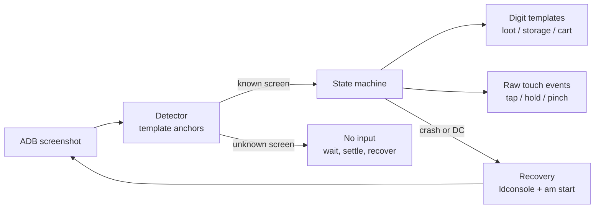

# Architecture

## How it works

- **Screens** are recognised by two or more small UI crops per screen (`anchors`), matched with OpenCV.
  A screen can have alternative anchor sets (`alt_anchors`) when it has two layouts, such as the win and loss result screens.
  The two villages are told apart by their elixir icons (pink in the Home Village, violet in the Builder Base), which
  every Town Hall and Builder Hall level shows, so a Town Hall below 7 (no dark elixir bar) is still the Home Village
  and never taken for the Builder Base.
  A search anchor that may sit anywhere in a wide region (the wall buttons) is matched at half size first, then at
  full size around the best spot, which keeps a screenshot's detection near 70 ms.
- **Numbers** (loot, storage bars, the "Maks" tooltip, the Elixir Cart, the battle's damage percent, the Builder Base
  trophies and the `xN` / `Nx` counts on the cards) are read with per-digit templates built from real screenshots.
  Several font variants per digit are supported. Builder Base stars and the hero's ability meter are read by colour.
- **Input** is sent as raw multitouch events written to `/dev/input/eventN`, which makes holds and pinches possible.

## Repository layout

- `src/coc_auto`: application package, CLI, device control, dashboard server, relay, scans, and upgrades.
- `src/coc_auto/resources`: default configuration, calibration images, catalogs, and message catalog.
- `web`: browser dashboard; served directly without a Node build step.
- `tests/python`, `tests/web`, `tests/fixtures`: offline tests and recorded screens.
- `scripts`: artwork/catalog refresh, calibration helpers, and Mac setup.
- `packaging`: Windows launcher, OCR dependency lock, and release tooling.
- `deploy`: optional hosted dashboard and relay services.

Resources are read-only at runtime. `coc_auto.paths` resolves resources independently
from user settings and runtime files. Default source checkouts retain their root
`config.local.json` and `.coc-auto` state. Packaged Windows builds use
`%LOCALAPPDATA%\CoC Auto`. An explicit `--config` retains sibling overrides and
relative asset paths for custom setups. `COC_AUTO_DATA_DIR` overrides the default
user-data location for isolated tests.

The three root Python files are compatibility launchers. Internal imports use the
`coc_auto` package; new application code belongs there. Calibration and catalog
refresh tools must write to resources, never to the user's runtime directory.
