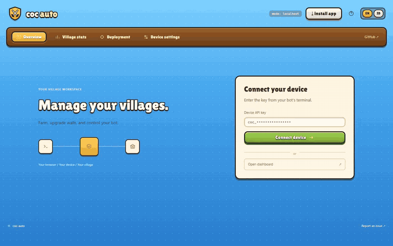
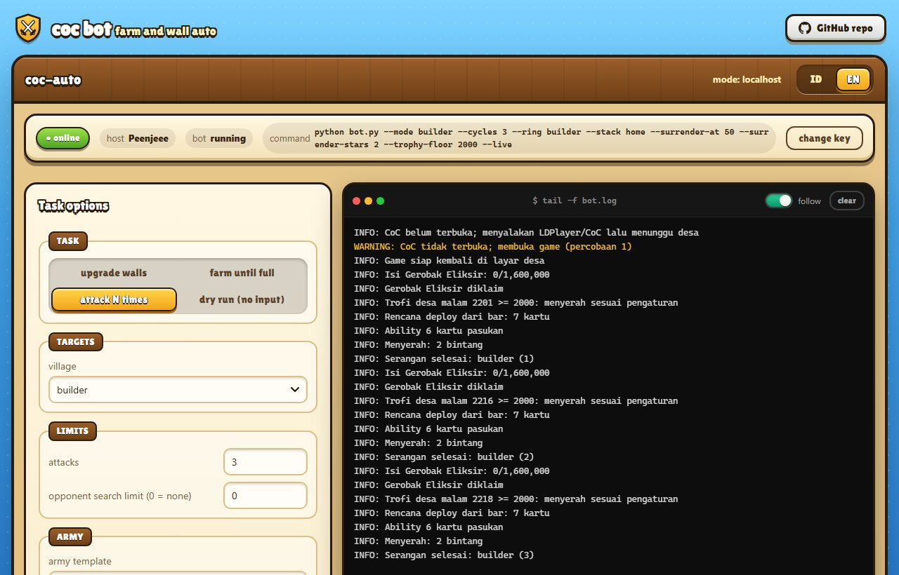

## Web dashboard

Every `bot.py` command prints this PC's **API key** (made once, kept in `~/.coc-auto/device.json`) and serves the
dashboard (open the address it prints in a browser). Enter the key there to follow the terminal log live and control the bot:

- **Local:** `http://localhost:8765`, served by the bot itself (works without internet).
- **Online:** `https://coc.0xpnj.dev`, for checking from a phone. The page and the online relay (this project's own
  `relay_server.py`, see [deploy/README.md](../../deploy/README.md)) run on one server; the PC connects out to a relay
  channel named after a hash of the key, so no router port has to be opened.



▶️ [Full-quality dashboard walkthrough (MP4)](../../docs/dashboard.mp4), recorded on the local dashboard with LDPlayer:
connecting with the key, the live view and its switch, one Builder Base attack started from the dashboard (sped up
8×), then Stats, the deploy pins on every map, LDPlayer auto-detect, Discord notifications and the switch to
Indonesian.



<p>
  
  
  
</p>

The screenshots are the dashboard's own preview, with sample data: add `?preview=1` to its address to look around
without a device.

You can open the dashboard locally, or online when you are out or away from the PC. For online use, the PC that runs
the bot must stay connected to the internet. Open [coc.0xpnj.dev](https://coc.0xpnj.dev) and enter the API key of the
PC that runs the bot; the key is printed in the terminal when the script starts.

> **ID:** Anda dapat membuka web lokal maupun online jika sedang di luar atau jauh dari perangkat. Pastikan perangkat
> yang menjalankan bot terhubung ke internet. Pantau lewat [coc.0xpnj.dev](https://coc.0xpnj.dev) dengan memasukkan
> API key dari perangkat yang menjalankan bot; key itu tampil di terminal saat script dijalankan.

The online dashboard installs as an app (PWA): press **install app** in its header or use the browser's own menu
(Install, or Share → Add to Home Screen on a phone). It opens
in its own window with the bot's icon; without a connection it still opens, and shows the PC as offline.

To run everything from the web without starting a task first:

```bash
python bot.py --agent
```

It shows the key and waits for **Start** from the dashboard. `python bot.py --key` only shows the key and exits; the
dashboard can control the PC only while `--agent` (or any other bot command) is running there.

The dashboard (Indonesian or English, switch in the title bar; the switch also sets the bot's terminal language,
`language` in config, and on connecting the dashboard puts the device on the language it is shown in) has five
pages. **Overview** shows whether the PC is online, the bot's state, run time, task and recoveries, the run setup,
a **Live view** of the LDPlayer screen and the **Activity** log. The live view is captured only while the page is
open and in view and its switch (in the panel's title, on by default) is on, once a second on the local and the
online dashboard (online, each frame crosses the relay); every frame replaces the last and none is stored. With the
switch off, **Refresh** still takes one frame. **Stats**, **Upgrade**, **Deployment** and **Device settings** are below. The run setup
covers every command above: the task, villages, resources to spend or fill, the Home Village loot minimum and
`--first`, then **Run limits** (`--bulk-walls`, attacks, searches, time, upgrades, `--wall-every`, recoveries),
**Army & deployment** (the army templates, ring or stack per village, `--quake`) and **Battle behavior**
(surrender: damage, stars, trophy floor, time). It shows the equivalent `python bot.py ...` line; **Start** runs it
(a running task is stopped first). Other buttons: stop bot, repeat the last command, open CoC, close CoC, restart
LDPlayer, turn LDPlayer off; the last three stop the bot first. When the PC is off, offline or the bot is not
running, the dashboard says so instead of sending, and a command that gets no answer within 10 seconds is reported.
Recovery and `settle` work the same under the dashboard: the task runs as a child process (`--worker`) of the
dashboard link.
The language switch updates live logs, recent log history, setup problems and visible notifications immediately,
without restarting the task. It changes display text only; CoC's language and screen detection are independent.

**Stats:** resource gains, completed attacks, wall upgrades (bulk upgrades included), building upgrades, recoveries, run time, attacks
per hour, run history and activity charts, for this run, 24 hours or 7 days. Home Gold/Elixir and Builder Gold/Elixir
are counted apart. The numbers come from the task's own log and are kept in `.coc-auto/stats.sqlite3` next to the
config, so closing the browser does not reset them. Resources are **measured storage increases**, never the loot
offered by a scouted opponent: the first reading is a baseline, a resource that was never read stays blank, and full
storages or spending between readings can hide gains.

**Discord notifications** send the bot's progress to a Discord channel, straight from the PC, whether you watch on
the local dashboard, the online one or neither. To set them up:

1. **Webhook URL:** in Discord, right-click your server → **Server Settings → Integrations → Webhooks → New Webhook**
   (or the channel's gear, **Edit Channel → Integrations → Create Webhook**). Pick the channel the messages go to,
   save, and press **Copy Webhook URL**. You need your own server or the *Manage Webhooks* permission. The webhook's
   avatar is used; the name shown is always **CoC Auto**.
2. **User ID** (optional, to be mentioned): **User Settings → Advanced → Developer Mode** on, then right-click your
   name → **Copy User ID**.
3. Start the bot (any command, or `python bot.py --agent`) and open the **local** dashboard, `http://localhost:8765`.
   The online dashboard shows the Discord status but refuses changes, so the webhook URL never crosses the relay.
4. **Device settings → Discord notifications:** paste the URL, the user ID if you want pings, pick the events, turn
   on **Enable notifications**, press **Save webhook**, then **Send test**: a "Webhook connected" message arrives in
   the channel.

| Event | When |
|-------|------|
| Run started | a task starts |
| Run ended or failed | it finishes, is stopped, or stops on an error |
| Recovery alerts | a recovery starts (a stuck screen, a closed game, low PC memory), at most once a minute |
| Progress reports | every 15, 30 or 60 minutes while a task runs |

Each message lists Home Gold/Elixir/Dark elixir, Builder Gold/Elixir, attacks, walls, building upgrades, recoveries, run time and
attacks per hour. The user ID is mentioned only on run end, failure, recovery and the test, and nobody else (no
roles, no @everyone). The URL is kept in `.coc-auto/discord.json` on the PC (not in git), never shown back in the
dashboard; only `discord.com` webhook URLs are accepted. Messages go out from a small background queue, so the game
never waits on Discord. Turn **Enable notifications** off to pause them, or **Remove** to forget the webhook. Anyone
holding the webhook URL can post to that channel: if it was shared by mistake, delete the webhook in Discord and make
a new one.

**Deploy points:** the deploy pins of the Home Village and both Builder Base stages are loaded when the dashboard
connects and drawn over a real attack screen of each (`web/maps/`), or over the last screenshot the bot took of
that deploy screen on this PC (taken while attacking, kept in `captures/`). Drag pins to
move them, add or remove numbered pins, and save: `D` is the deploy point (troops, siege and heroes; the Battle
Machine/Copter), the numbered pins are the Home Village spell points (rounds of front, left, right) or the Builder
Base points, one per troop card. Three more Home Village tabs move the `--ring` pins round the map edge (troops),
the spell pins over the middle of the base (skeletons, `--ring` without `--quake`) and the `--quake` pins on the
walls at the base top, right, bottom and left. Pins cannot go on the card bar. The device checks them like any calibration,
writes them to `config.local.json` (the previous one stays as `config.local.json.bak`; `config.json` is never
rewritten), and they apply at the next Start.

**Device settings:** loaded when the dashboard connects. *Minimum opponent loot* sets the Home Village gold, elixir
and dark elixir filter (`minimum`; `0` = no filter). *LDPlayer* holds `adb`, `ldconsole`, `serial`, `ld_index` and
`touch_device`; **auto-detect** fills them from what it finds on the PC (it only reads: `ldconsole list2`,
`adb devices`, `getevent -pl`, `wm size`) and lists problems, such as LDPlayer being off or a wrong resolution.
Nothing changes until you press save. The device accepts only LDPlayer's own `adb.exe` and `ldconsole.exe` as
paths, checks the rest like any calibration, saves to `config.local.json` (the previous one stays as
`config.local.json.bak`), and the change applies at the next Start.

**LDPlayer screen:** shows the instance's resolution and DPI next to the calibration (1280×720, DPI 240). "Fit
screen" stops the bot, closes LDPlayer, waits for its virtual machine to stop, writes only the resolution, the DPI,
ADB debugging (turned on) and ASTC texture decoding (turned off) into its instance file
(`vms\config\leidian<index>.config`; `ldconsole modify` is never used because it drops other settings) and starts
LDPlayer again. A live run does the same by itself on any other screen, with ADB debugging off or with ASTC on. With
ASTC on, LDPlayer's VM grows about twice as fast while CoC battles (+4.6 GB in 30 minutes of farming against +2.2 GB
with it off); CoC looks the same either way. Restoring your screen leaves ADB debugging on and ASTC off.
Your own resolution and DPI are kept in `~/.coc-auto/display.json` and are put back when you leave the dashboard link
with **Ctrl+C**, when a `--no-remote` run ends, or with "restore my screen". LDPlayer is restarted for a restore only
if it is running.

**Upgrade** (its own page, after Stats): **Sync from game** opens the profile, Settings, More Settings and
**Data Export**, locates the export row and presses **Copy**. LDPlayer synchronizes the JSON to the Windows
clipboard. The bot validates that a new export was copied and returns to the village. A single sync refreshes all
six tabs with the game's exact current levels, grouped counts and running-upgrade timers; these values use no OCR.
The screen must be 1280x720, the game must use English or Indonesian, and LDPlayer clipboard synchronization must
be enabled. Stop farming first; sync is refused while a task runs. The sync returns to the village after copying the export.
Game IDs are mapped using the pinned `village-export-catalog.json`; `scripts/sync_export_catalog.py` refreshes it.
Different levels of the same building stay separate. Completed groups at their pinned global maximum level are hidden from
the available list. Lower-level copies, running upgrades, unknown IDs and levels newer than the catalog stay visible.
Filtering also applies to saved scans; it does not remove raw inventory or existing queue selections. Unknown IDs and modular items without a building level are
shown read-only, rather than assigned a guessed level. Walls use the separate wall-upgrade task.
The export does not supply upgrade prices or the game's suggested/locked-row ordering. Sync does not invent those
values. The upgrade worker still finds actual upgrade rows and checks current prices, resource icons, dialogs and
gems visually before any purchase. This safety checking continues to use its existing OCR and templates.
The last scan is kept on the PC, in the same `.coc-auto/stats.sqlite3` as the stats (next to the config, not in git),
and shown again when the dashboard is reopened, with its date and time; running upgrades count down from that scan,
and **Sync again** copies a fresh export. A stale clipboard or invalid export preserves previous scans.
The original JSON is kept locally in `.coc-auto/village-export.json`.
**Ongoing** shows running upgrades from all six saved lists, ordered by expected finish time. Compact cards show
the entity, level change, remaining time and a progress bar. The last-sync time stays visible; countdowns update
locally without additional ADB screenshots. Use **Sync again** to refresh the game's timers. A countdown reaching
zero says **Ready to check** until another sync confirms completion. Standard catalog durations support estimated
progress, marked `~`; discounts, boosts and helpers can change the actual duration. Unknown durations have no
invented percentage. Expected finish times are available by hovering the remaining time and in its accessible label.

Artwork uses six bundled sprite sheets instead of individual entity images; see
[artwork regeneration and size tradeoffs](../../web/icons/entities/README.md).

Confirmed upgrades are recorded locally in `.coc-auto/upgrade-history.sqlite3`. When the action screen has no
readable level, reporting uses the last export and confirmed receipts where they identify one unambiguous level.
Mixed-level groups stay unspecified. This history affects logs only; purchase checks continue to use the game screen.

Use the tabs and search to find an upgrade, then choose **Add** to put it in the queue.
Choose **Remove** to take it out. Drag the queue handle to change priority; keyboard users can focus the handle,
and use Up, Down, Home or End to change its position. Each target can stop at **Max** or a chosen
**Level**. Queue edits stay in the browser until **Save queue** is pressed and are preserved when switching tabs.
The number of builders to keep free applies to Home Village buildings.

**Goblin helpers** has separate Builder and Researcher switches and a per-upgrade gem limit. These settings have
their own save button. The helper may spend gems only when enabled and within the saved limit.

The six tabs cover Home Village Buildings, Laboratory, Pets and Equipment, plus Builder Base Buildings and Star
Laboratory. Each has its own queue and saved rows. Syncing any tab refreshes every tab from the same export.
Names are resolved by numeric game ID, so similarly named buildings and troops are not confused.
Picks other than the Home Village buildings keep no builders free and are saved to `config.local.json` under the
list's name (`lab`, `pets`, `gear`, `builder`, `star`). The **upgrade buildings** task works through every list's
picks (see [Upgrading buildings](#upgrading-buildings)).

Security: commands are signed with the API key (HMAC-SHA256, valid for 2 minutes, never reused, never older than
the running bot), and everything the PC sends online is signed with it too, so nobody else on the channel can pose
as the device or as the dashboard. The key itself never leaves the browser or the PC, and the page loads no
third-party code: even its font, Lilita One, is served from `web/fonts/` (SIL Open Font License, `web/fonts/OFL.txt`). Only the options the CLI offers are accepted. The local dashboard listens on 127.0.0.1 only and
refuses other sites (Host, Origin and JSON checks). Use `--new-key` if the key was shared by mistake.

The online relay is already set up: the PC reads `remote.relay_url` and `remote.relay_key` from `config.json`, and
the page connects to its own address with the same relay token (`RELAY_KEY` in `web/config.js`). The token only lets
a client join channels, so it is public; everything on a channel is signed with the device key. There is nothing to
configure for online use. The relay forwards messages and stores none; like any web server, the online host keeps an
access log (addresses and pages visited), never frames, logs or commands. Hosting the page and relay on a server of
your own is described in [deploy/README.md](../../deploy/README.md).
